# LNL Motion Effects

30 hiệu ứng motion graphic dựng bằng **HyperFrames + GSAP**, chữ tiếng Việt (Be Vietnam Pro), 4 bộ màu dựng sẵn. Tự thiết kế và viết mới.

Xem online: https://effects.luangroup.asia/

## Dùng một hiệu ứng
```sh
cd effects/<ten-hieu-ung>
npx hyperframes preview   # xem, sửa trực tiếp
npx hyperframes render    # xuất MP4 1920x1080
```
Chữ có `data-var-text` sửa trong `compositions/fx.html`; màu là 6 biến trong `#root` của `index.html` (bảng màu ở `spec.md` từng hiệu ứng).

## Đưa lên web
Trang chạy trên Cloudflare (Workers Static Assets) ở https://effects.luangroup.asia/: `node tools/gallery.mjs && node tools/dist.mjs && npx wrangler deploy`. Cache: trang chính hỏi lại mỗi lần (Cloudflare giữ 5 phút), video và ảnh lưu 1 ngày (`_headers`).

## Thêm hiệu ứng
Viết thêm một mục trong `tools/effects.mjs`, rồi `node tools/build.mjs` (sinh dự án), kiểm tra bằng `npx hyperframes check`, render `preview.mp4` / `poster.jpg`, và `node tools/gallery.mjs` (trang thư viện + README).

## Mở đầu

| Xem trước | Hiệu ứng | Thời lượng |
|---|---|---|
| [](effects/title-stack/preview.mp4) | **[Tiêu đề xếp tầng](effects/title-stack/)**<br>Ba dòng tiêu đề trượt lên từ sau mặt nạ, dòng nhấn đổi màu, gạch chân chạy ngang rồi nhãn nhỏ bật lên.<br><sub>Dùng khi: Mở đầu video, giới thiệu chủ đề, tên chương.</sub> | 5s |
| [](effects/feature-orbit/preview.mp4) | **[Tính năng quay quanh sản phẩm](effects/feature-orbit/)**<br>Thẻ sản phẩm ở giữa, sáu nhãn tính năng bay ra theo vòng quỹ đạo, xoay chậm một vòng rồi dừng đúng chỗ.<br><sub>Dùng khi: Giới thiệu sản phẩm, app, gói dịch vụ có nhiều tính năng.</sub> | 7s |
| [](effects/logo-split/preview.mp4) | **[Màn tách đôi lộ logo](effects/logo-split/)**<br>Hai tấm màu che kín màn hình tách ra hai phía, logo phóng nhẹ ở giữa, dòng khẩu hiệu gõ ra bên dưới.<br><sub>Dùng khi: Mở hoặc kết video thương hiệu, end card.</sub> | 4s |
| [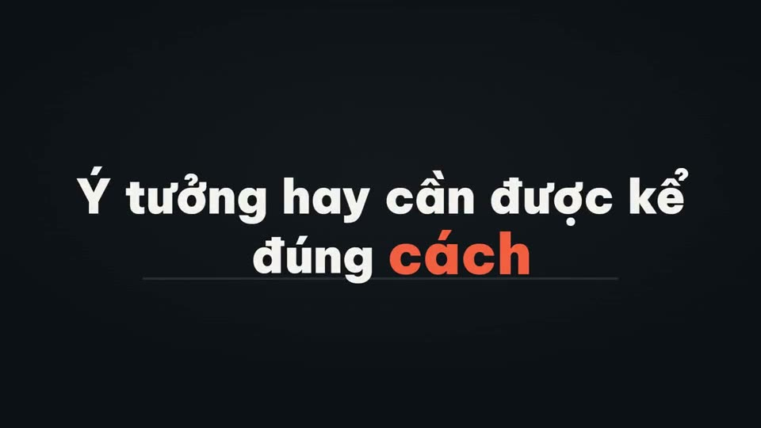](effects/word-cascade/preview.mp4) | **[Chữ rơi nảy vào chỗ](effects/word-cascade/)**<br>Từng chữ của câu rơi từ trên xuống, nảy nhẹ khi chạm vạch, từ nhấn cuối cùng phóng to và đổi màu.<br><sub>Dùng khi: Câu mở đầu, khẩu hiệu, câu chốt cuối video.</sub> | 5s |
| [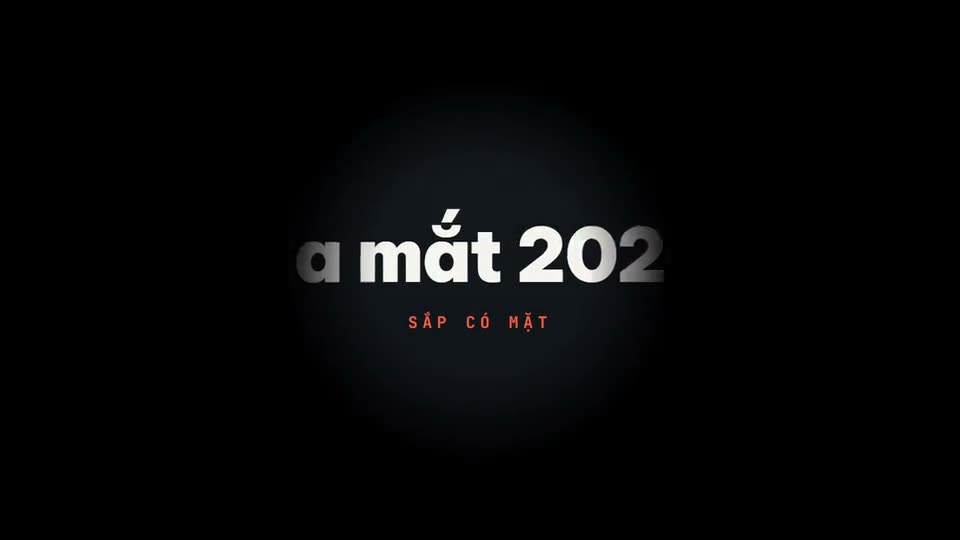](effects/spotlight-title/preview.mp4) | **[Đèn rọi lộ tiêu đề](effects/spotlight-title/)**<br>Màn hình tối, một vòng đèn rọi lướt qua để lộ dần dòng tiêu đề, rồi đèn bung rộng sáng toàn cảnh.<br><sub>Dùng khi: Mở màn bí ẩn, giới thiệu sản phẩm mới, tiết lộ tên dự án.</sub> | 5s |
| [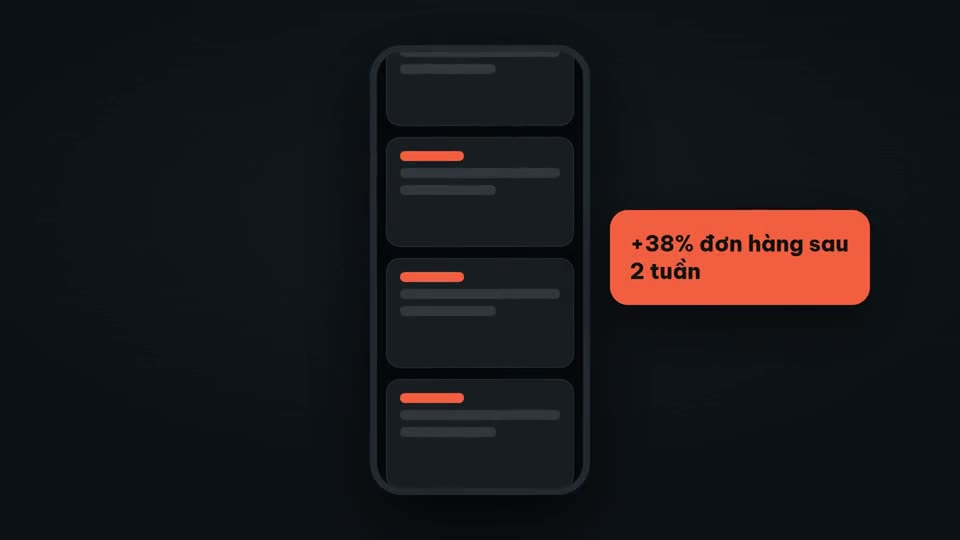](effects/phone-scroll/preview.mp4) | **[Điện thoại cuộn nội dung](effects/phone-scroll/)**<br>Khung điện thoại nổi lên nghiêng nhẹ, màn hình cuộn qua các thẻ nội dung, thẻ nổi bật bung ra ngoài khung.<br><sub>Dùng khi: Giới thiệu app, giao diện mạng xã hội, trang sản phẩm trên di động.</sub> | 6s |

## Con số

| Xem trước | Hiệu ứng | Thời lượng |
|---|---|---|
| [](effects/stat-cards/preview.mp4) | **[Ba thẻ số liệu đếm lên](effects/stat-cards/)**<br>Ba thẻ nổi lên lệch nhịp, mỗi thẻ đếm số từ 0, thanh tiến độ chạy theo, thẻ giữa sáng viền nhấn.<br><sub>Dùng khi: Khoe thành tích, số liệu dự án, kết quả khách hàng.</sub> | 6s |
| [](effects/bar-rise/preview.mp4) | **[Biểu đồ cột mọc lên](effects/bar-rise/)**<br>Trục và lưới vẽ ra, năm cột mọc từ đáy theo thứ tự, nhãn giá trị đếm theo chiều cao, cột cao nhất đổi màu nhấn.<br><sub>Dùng khi: So sánh doanh thu theo năm, theo kênh, theo sản phẩm.</sub> | 6s |
| [](effects/before-after/preview.mp4) | **[So sánh trước và sau](effects/before-after/)**<br>Hai nửa màn hình với nhãn TRƯỚC / SAU, thanh chia trượt qua lại rồi dừng giữa, số liệu hai bên đếm lên.<br><sub>Dùng khi: Kết quả trước và sau khi dùng sản phẩm, so sánh hai phương án.</sub> | 6s |
| [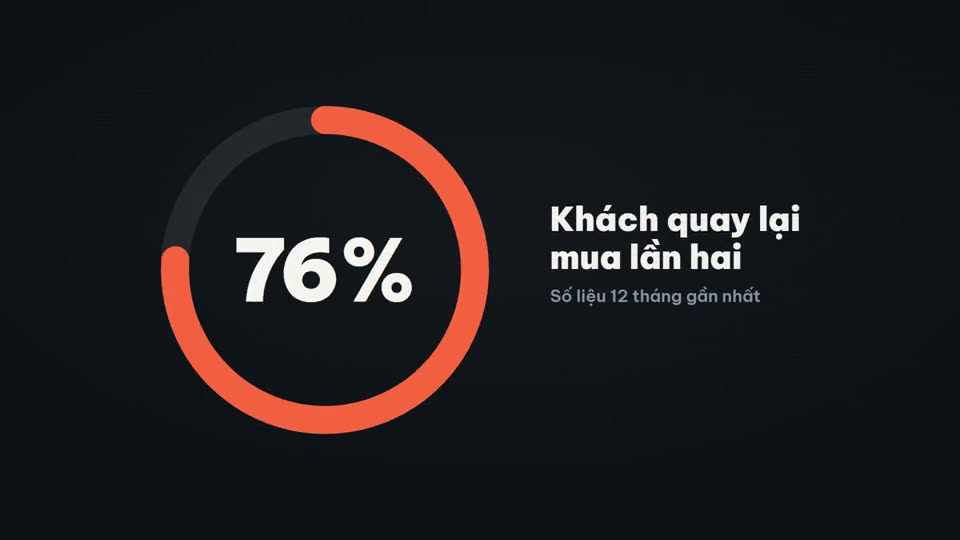](effects/donut-percent/preview.mp4) | **[Vòng tròn phần trăm](effects/donut-percent/)**<br>Vòng tròn vẽ ra theo tỉ lệ, số ở giữa đếm lên cùng nhịp, nhãn giải thích trượt vào bên cạnh.<br><sub>Dùng khi: Tỉ lệ hoàn thành, tỉ lệ hài lòng, thị phần.</sub> | 5s |
| [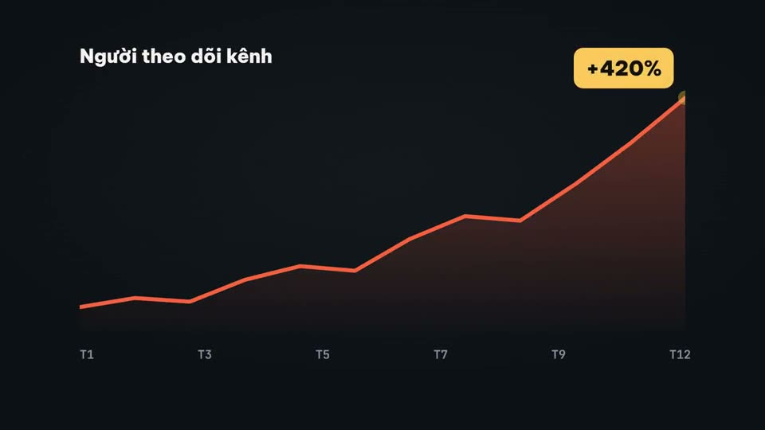](effects/line-growth/preview.mp4) | **[Đường tăng trưởng](effects/line-growth/)**<br>Đường biểu đồ vẽ từ trái sang phải với vùng tô mờ bên dưới, chấm cuối nhấp nháy và nhãn tăng trưởng bật lên.<br><sub>Dùng khi: Doanh thu theo tháng, lượt theo dõi kênh, giá trị tăng theo thời gian.</sub> | 6s |
| [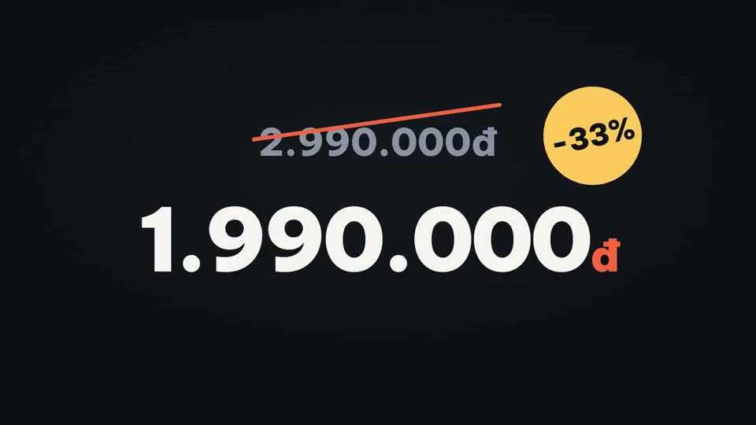](effects/price-drop/preview.mp4) | **[Giá giảm bật lên](effects/price-drop/)**<br>Giá cũ hiện ra rồi bị gạch chéo, giá mới đập xuống với rung nhẹ, tem phần trăm xoay vào góc.<br><sub>Dùng khi: Khuyến mãi, flash sale, ưu đãi mở bán.</sub> | 5s |
| [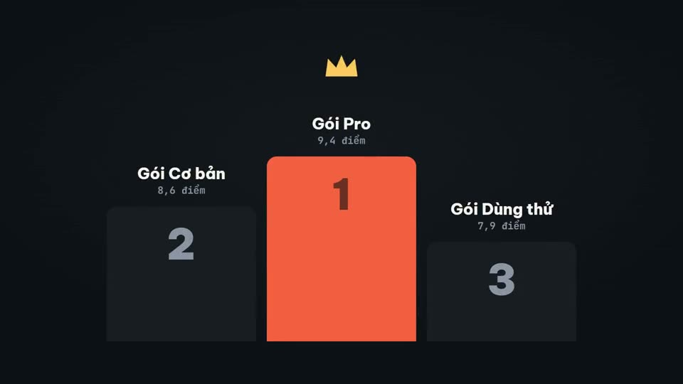](effects/podium-rank/preview.mp4) | **[Bục xếp hạng](effects/podium-rank/)**<br>Ba bục 2–1–3 mọc lên theo thứ tự hạng ba, hạng hai, hạng nhất; tên và điểm hiện trên bục, hạng nhất có vương miện.<br><sub>Dùng khi: Top sản phẩm bán chạy, bảng xếp hạng nhân viên, so sánh ba lựa chọn.</sub> | 6s |

## Danh sách

| Xem trước | Hiệu ứng | Thời lượng |
|---|---|---|
| [](effects/check-list/preview.mp4) | **[Danh sách tích dấu](effects/check-list/)**<br>Bốn dòng hiện lần lượt, ô vuông tự vẽ dấu tích bằng nét, chữ dòng đã xong mờ đi và gạch ngang nhẹ.<br><sub>Dùng khi: Các bước làm, quyền lợi gói, việc cần chuẩn bị.</sub> | 6s |
| [](effects/step-timeline/preview.mp4) | **[Dòng thời gian bốn mốc](effects/step-timeline/)**<br>Đường ngang vẽ dần, chấm sáng chạy dọc đường, tới đâu mốc đó bật lên kèm năm và mô tả ngắn.<br><sub>Dùng khi: Lộ trình dự án, lịch sử thương hiệu, các bước quy trình.</sub> | 6s |
| [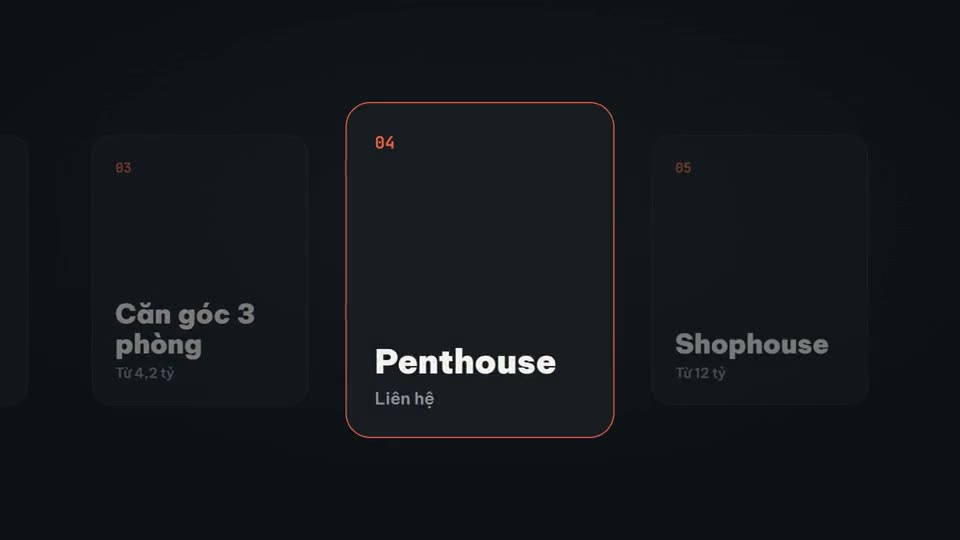](effects/card-carousel/preview.mp4) | **[Băng chuyền thẻ](effects/card-carousel/)**<br>Năm thẻ xếp ngang trượt qua giữa màn hình, thẻ vào giữa phóng to và sáng lên, thẻ hai bên lùi mờ.<br><sub>Dùng khi: Giới thiệu nhiều sản phẩm, nhiều gói dịch vụ, nhiều dự án.</sub> | 7s |
| [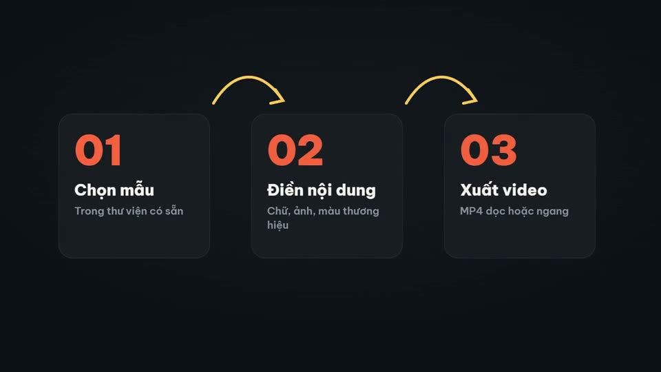](effects/three-steps/preview.mp4) | **[Ba bước có mũi tên nối](effects/three-steps/)**<br>Ba khối bước với số to hiện lần lượt, mũi tên cong tự vẽ nối bước trước sang bước sau.<br><sub>Dùng khi: Quy trình đặt hàng, cách dùng sản phẩm, hướng dẫn nhanh.</sub> | 6s |
| [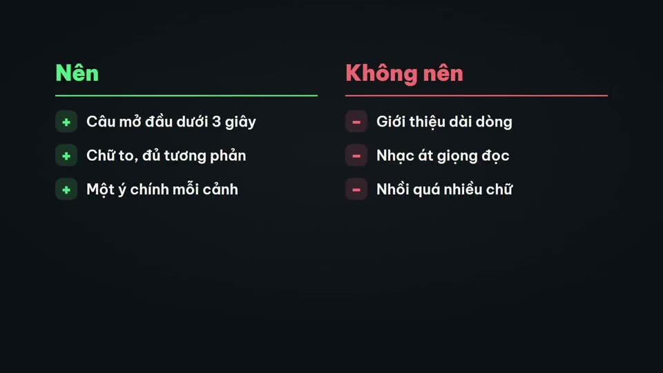](effects/pros-cons/preview.mp4) | **[Ưu và nhược hai cột](effects/pros-cons/)**<br>Hai cột tiêu đề Nên / Không nên, các dòng hiện xen kẽ hai bên với dấu cộng xanh và dấu trừ đỏ bật lên.<br><sub>Dùng khi: So sánh hai lựa chọn, việc nên và không nên, ưu nhược điểm.</sub> | 6s |

## Giải thích

| Xem trước | Hiệu ứng | Thời lượng |
|---|---|---|
| [](effects/ai-chat/preview.mp4) | **[Khung chat AI gõ và trả lời](effects/ai-chat/)**<br>Cửa sổ chat mở ra, câu hỏi gõ từng chữ rồi gửi, ba chấm chờ nhấp nháy, câu trả lời hiện theo từng từ.<br><sub>Dùng khi: Minh hoạ dùng ChatGPT, Claude, trợ lý AI trong video hướng dẫn.</sub> | 7s |
| [](effects/name-strap/preview.mp4) | **[Thanh tên người nói](effects/name-strap/)**<br>Khối màu trượt vào góc dưới trái, tên và chức danh lộ ra sau mặt nạ, vạch nhấn chạy dọc, giữ rồi rút gọn gàng.<br><sub>Dùng khi: Giới thiệu người nói trong video phỏng vấn, livestream, talking head.</sub> | 5s |
| [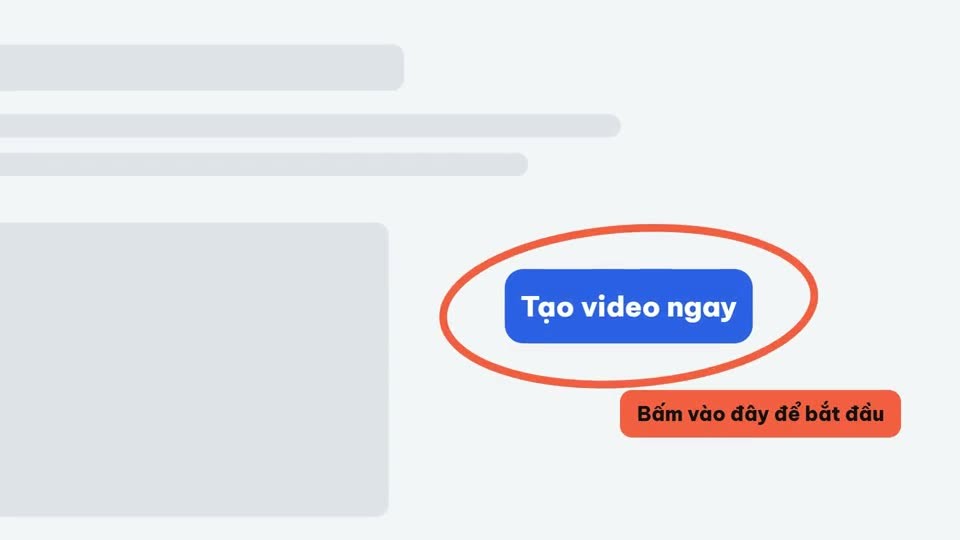](effects/browser-callout/preview.mp4) | **[Khoanh vùng trên trang web](effects/browser-callout/)**<br>Cửa sổ trình duyệt hiện lên, vòng tròn tự vẽ khoanh vào một nút, máy quay đẩy vào vùng đó và chú thích hiện ra.<br><sub>Dùng khi: Hướng dẫn thao tác trên web, chỉ chỗ bấm, giải thích tính năng.</sub> | 6s |
| [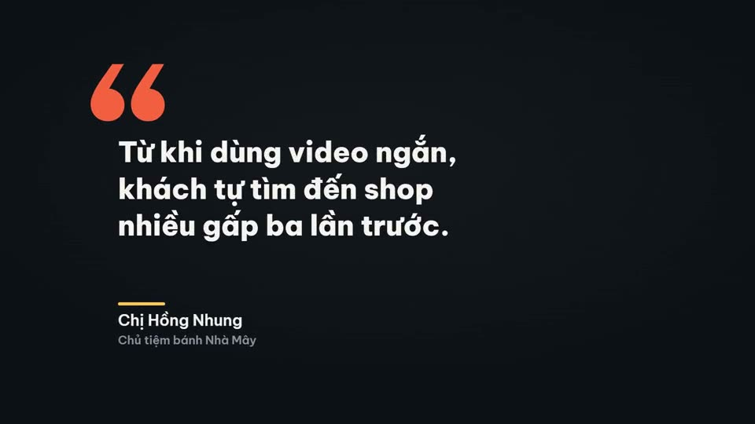](effects/quote-card/preview.mp4) | **[Thẻ trích dẫn](effects/quote-card/)**<br>Dấu ngoặc kép lớn bật vào, câu trích dẫn hiện theo từng dòng, gạch nhấn chạy dưới tên người nói.<br><sub>Dùng khi: Lời khách hàng, câu nói nổi tiếng, nhận xét chuyên gia.</sub> | 6s |
| [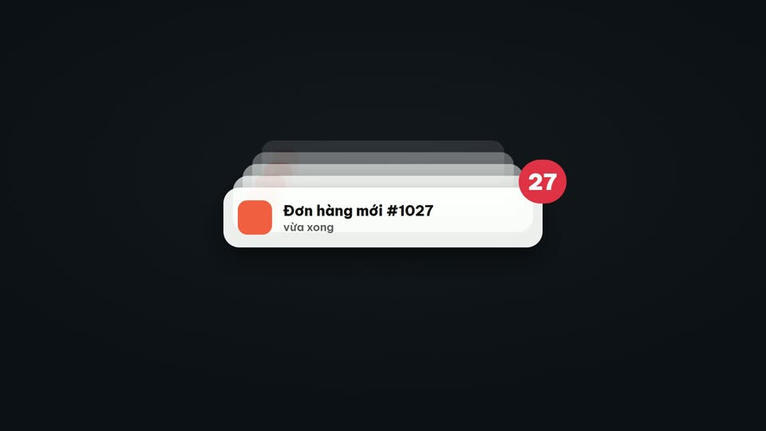](effects/notif-stack/preview.mp4) | **[Thông báo đổ dồn](effects/notif-stack/)**<br>Các thông báo kiểu điện thoại rơi xuống xếp chồng, thông báo cũ lùi sâu và mờ dần, số đếm trên biểu tượng tăng lên.<br><sub>Dùng khi: Đơn hàng về liên tục, tin nhắn khách hàng, hiệu ứng "bùng nổ" sau chiến dịch.</sub> | 6s |
| [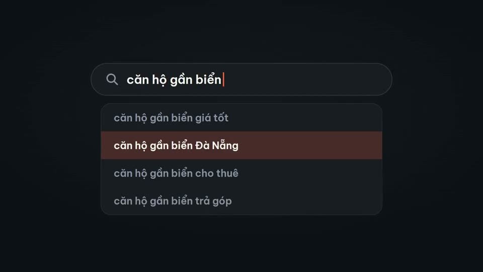](effects/search-suggest/preview.mp4) | **[Ô tìm kiếm gợi ý](effects/search-suggest/)**<br>Ô tìm kiếm lớn, chữ gõ từng ký tự, danh sách gợi ý thả xuống, dòng phù hợp sáng lên rồi được chọn.<br><sub>Dùng khi: Nói về từ khoá khách tìm, SEO, minh hoạ cách tra cứu.</sub> | 6s |

## Chữ

| Xem trước | Hiệu ứng | Thời lượng |
|---|---|---|
| [](effects/glitch-word/preview.mp4) | **[Chữ nhiễu tách màu](effects/glitch-word/)**<br>Từ khoá xuất hiện kiểu tín hiệu lỗi: ba lớp màu lệch nhau, dải cắt ngang giật, rồi khớp lại thành chữ sạch.<br><sub>Dùng khi: Nhấn từ khoá, chuyển đoạn kiểu công nghệ, mở đầu nhanh.</sub> | 4s |
| [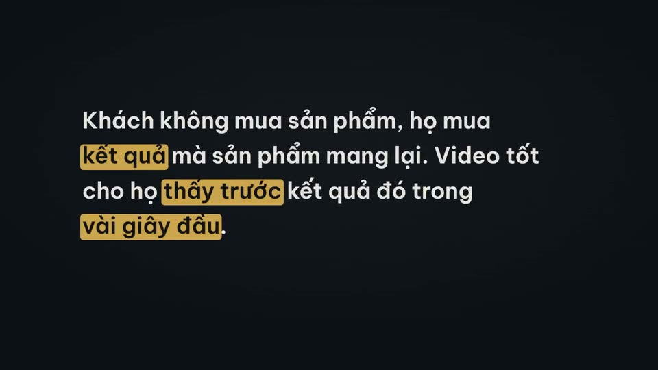](effects/marker-highlight/preview.mp4) | **[Bút dạ quang tô từ khoá](effects/marker-highlight/)**<br>Đoạn văn hiện ra, nét bút dạ quang quét lần lượt qua các từ khoá theo nhịp đọc, đoạn còn lại mờ đi.<br><sub>Dùng khi: Nhấn ý chính trong trích dẫn, điều khoản, đoạn giải thích.</sub> | 6s |
| [](effects/type-correct/preview.mp4) | **[Gõ chữ rồi sửa từ](effects/type-correct/)**<br>Dòng chữ gõ như máy đánh chữ, con trỏ dừng, xoá lùi một từ rồi gõ lại từ đúng với màu nhấn.<br><sub>Dùng khi: Đổi góc nhìn ("không phải… mà là…"), chơi chữ, câu hook gây tò mò.</sub> | 6s |
| [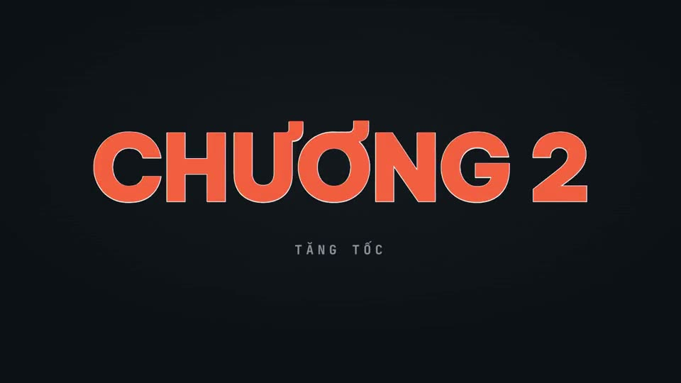](effects/outline-fill/preview.mp4) | **[Chữ viền đổ đầy màu](effects/outline-fill/)**<br>Chữ lớn chỉ có viền vẽ ra trước, sau đó màu đổ đầy từ dưới lên như nước dâng, dòng phụ hiện bên dưới.<br><sub>Dùng khi: Tiêu đề chương, con số lớn, tên thương hiệu.</sub> | 5s |

## Chuyển cảnh

| Xem trước | Hiệu ứng | Thời lượng |
|---|---|---|
| [](effects/tile-wipe/preview.mp4) | **[Chuyển cảnh ô lưới lật](effects/tile-wipe/)**<br>Màn hình chia lưới 8×5, các ô lật theo đường chéo để che cảnh cũ rồi lật tiếp để lộ cảnh mới.<br><sub>Dùng khi: Chuyển giữa hai đoạn, chuyển sang chương mới.</sub> | 3s |
| [](effects/circle-iris/preview.mp4) | **[Chuyển cảnh vòng tròn mở](effects/circle-iris/)**<br>Một chấm màu ở giữa nở thành vòng tròn phủ kín cảnh cũ, rồi vòng thứ hai mở ra từ đó để lộ cảnh mới.<br><sub>Dùng khi: Chuyển đoạn mềm mại, chuyển sang chủ đề mới, hiệu ứng "zoom vào".</sub> | 3s |

## Bộ màu

| Bộ | Nền | Nhấn | Nhấn 2 |
|---|---|---|---|
| Than & cam san hô | #0e1116 | #ff6b3d | #ffc857 |
| Đêm xanh | #07101f | #4f8bff | #7cf0d4 |
| Rừng xanh | #0c1510 | #5ed17e | #e9d36a |
| Giấy sáng | #f6f2ea | #e8461f | #2f6bff |

## Giấy phép
Mã nguồn theo giấy phép MIT (xem `LICENSE`). Phông Be Vietnam Pro và JetBrains Mono theo SIL Open Font License.
