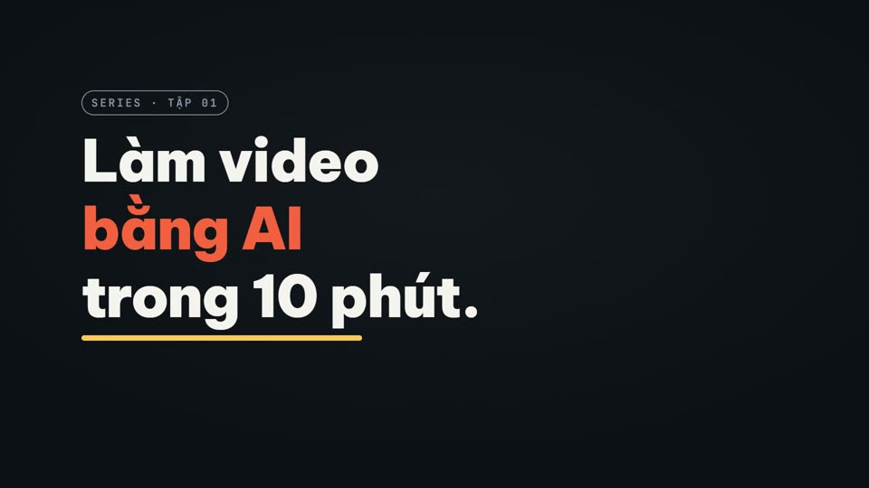
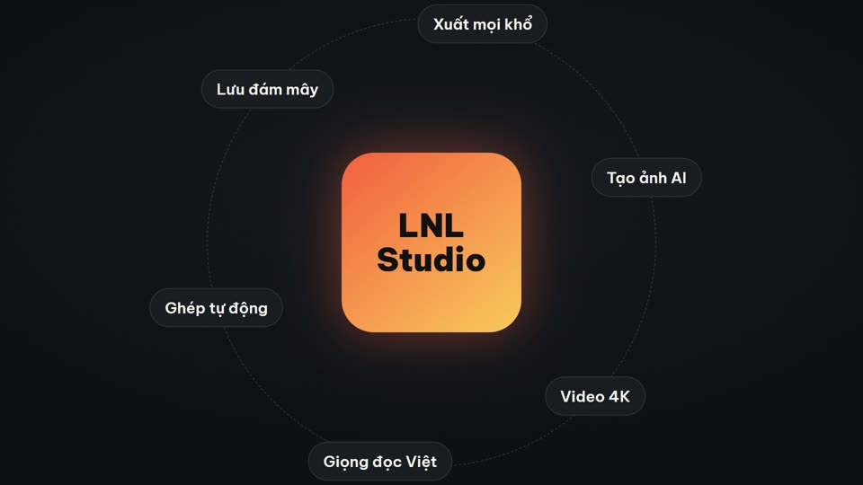
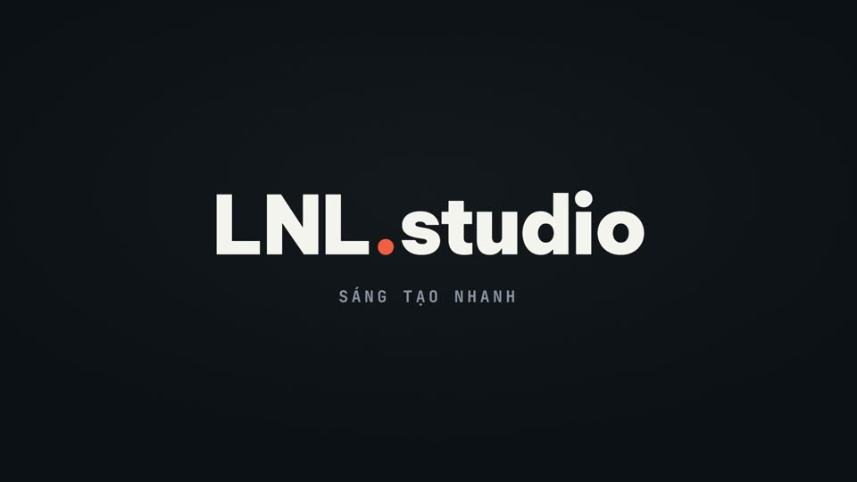
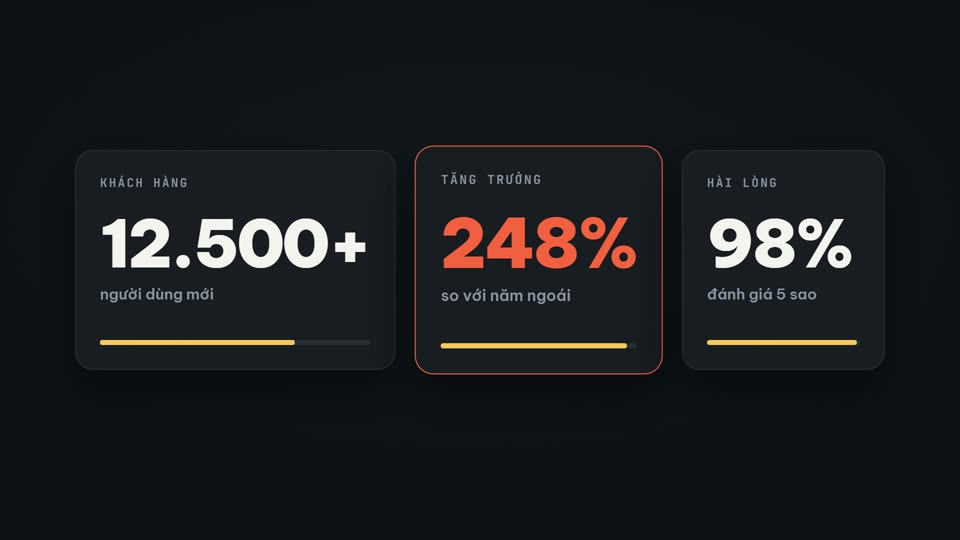
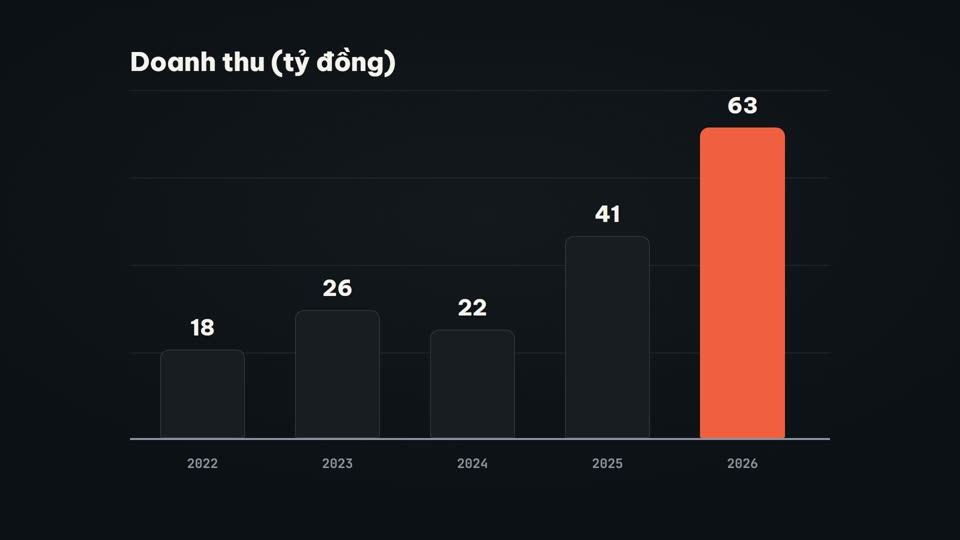
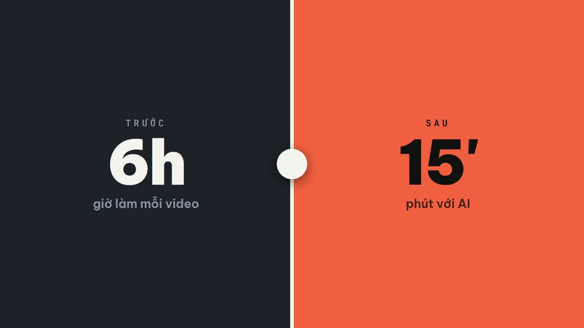
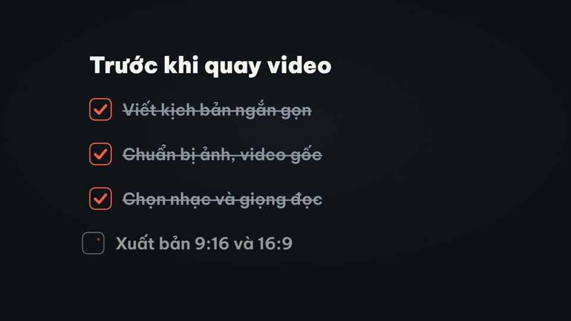
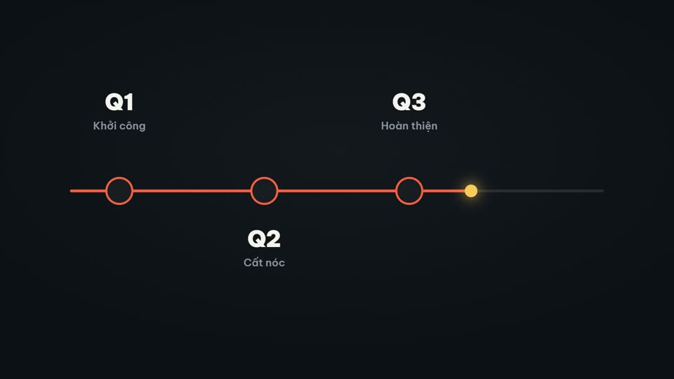
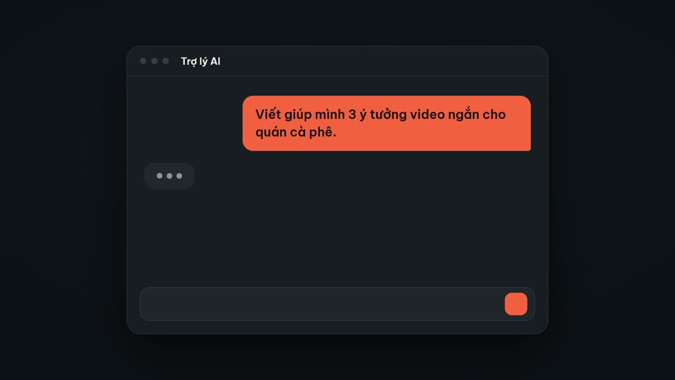
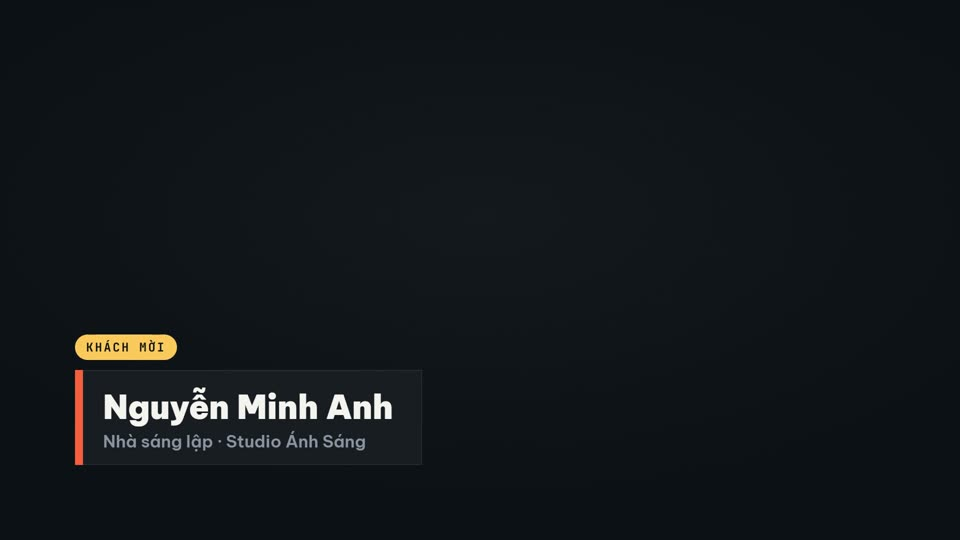

# LNL Motion Effects

12 hiệu ứng motion graphic dựng bằng **HyperFrames + GSAP**, chữ tiếng Việt (Be Vietnam Pro), 4 bộ màu dựng sẵn. Tự thiết kế và viết mới.

Xem online: https://luanlengoc1991-art.github.io/lnl-motion-effects/

## Dùng một hiệu ứng
```sh
cd effects/<ten-hieu-ung>
npx hyperframes preview   # xem, sửa trực tiếp
npx hyperframes render    # xuất MP4 1920x1080
```
Chữ có `data-var-text` sửa trong `compositions/fx.html`; màu là 6 biến trong `#root` của `index.html` (bảng màu ở `spec.md` từng hiệu ứng).

## Thêm hiệu ứng
Viết thêm một mục trong `tools/effects.mjs`, rồi `node tools/build.mjs` (sinh dự án), kiểm tra bằng `npx hyperframes check`, render `preview.mp4` / `poster.jpg`, và `node tools/gallery.mjs` (trang thư viện + README).

## Mở đầu

| Xem trước | Hiệu ứng | Thời lượng |
|---|---|---|
| [](effects/title-stack/preview.mp4) | **[Tiêu đề xếp tầng](effects/title-stack/)**<br>Ba dòng tiêu đề trượt lên từ sau mặt nạ, dòng nhấn đổi màu, gạch chân chạy ngang rồi nhãn nhỏ bật lên.<br><sub>Dùng khi: Mở đầu video, giới thiệu chủ đề, tên chương.</sub> | 5s |
| [](effects/feature-orbit/preview.mp4) | **[Tính năng quay quanh sản phẩm](effects/feature-orbit/)**<br>Thẻ sản phẩm ở giữa, sáu nhãn tính năng bay ra theo vòng quỹ đạo, xoay chậm một vòng rồi dừng đúng chỗ.<br><sub>Dùng khi: Giới thiệu sản phẩm, app, gói dịch vụ có nhiều tính năng.</sub> | 7s |
| [](effects/logo-split/preview.mp4) | **[Màn tách đôi lộ logo](effects/logo-split/)**<br>Hai tấm màu che kín màn hình tách ra hai phía, logo phóng nhẹ ở giữa, dòng khẩu hiệu gõ ra bên dưới.<br><sub>Dùng khi: Mở hoặc kết video thương hiệu, end card.</sub> | 4s |

## Con số

| Xem trước | Hiệu ứng | Thời lượng |
|---|---|---|
| [](effects/stat-cards/preview.mp4) | **[Ba thẻ số liệu đếm lên](effects/stat-cards/)**<br>Ba thẻ nổi lên lệch nhịp, mỗi thẻ đếm số từ 0, thanh tiến độ chạy theo, thẻ giữa sáng viền nhấn.<br><sub>Dùng khi: Khoe thành tích, số liệu dự án, kết quả khách hàng.</sub> | 6s |
| [](effects/bar-rise/preview.mp4) | **[Biểu đồ cột mọc lên](effects/bar-rise/)**<br>Trục và lưới vẽ ra, năm cột mọc từ đáy theo thứ tự, nhãn giá trị đếm theo chiều cao, cột cao nhất đổi màu nhấn.<br><sub>Dùng khi: So sánh doanh thu theo năm, theo kênh, theo sản phẩm.</sub> | 6s |
| [](effects/before-after/preview.mp4) | **[So sánh trước và sau](effects/before-after/)**<br>Hai nửa màn hình với nhãn TRƯỚC / SAU, thanh chia trượt qua lại rồi dừng giữa, số liệu hai bên đếm lên.<br><sub>Dùng khi: Kết quả trước và sau khi dùng sản phẩm, so sánh hai phương án.</sub> | 6s |

## Danh sách

| Xem trước | Hiệu ứng | Thời lượng |
|---|---|---|
| [](effects/check-list/preview.mp4) | **[Danh sách tích dấu](effects/check-list/)**<br>Bốn dòng hiện lần lượt, ô vuông tự vẽ dấu tích bằng nét, chữ dòng đã xong mờ đi và gạch ngang nhẹ.<br><sub>Dùng khi: Các bước làm, quyền lợi gói, việc cần chuẩn bị.</sub> | 6s |
| [](effects/step-timeline/preview.mp4) | **[Dòng thời gian bốn mốc](effects/step-timeline/)**<br>Đường ngang vẽ dần, chấm sáng chạy dọc đường, tới đâu mốc đó bật lên kèm năm và mô tả ngắn.<br><sub>Dùng khi: Lộ trình dự án, lịch sử thương hiệu, các bước quy trình.</sub> | 6s |

## Giải thích

| Xem trước | Hiệu ứng | Thời lượng |
|---|---|---|
| [](effects/ai-chat/preview.mp4) | **[Khung chat AI gõ và trả lời](effects/ai-chat/)**<br>Cửa sổ chat mở ra, câu hỏi gõ từng chữ rồi gửi, ba chấm chờ nhấp nháy, câu trả lời hiện theo từng từ.<br><sub>Dùng khi: Minh hoạ dùng ChatGPT, Claude, trợ lý AI trong video hướng dẫn.</sub> | 7s |
| [](effects/name-strap/preview.mp4) | **[Thanh tên người nói](effects/name-strap/)**<br>Khối màu trượt vào góc dưới trái, tên và chức danh lộ ra sau mặt nạ, vạch nhấn chạy dọc, giữ rồi rút gọn gàng.<br><sub>Dùng khi: Giới thiệu người nói trong video phỏng vấn, livestream, talking head.</sub> | 5s |

## Chữ

| Xem trước | Hiệu ứng | Thời lượng |
|---|---|---|
| [](effects/glitch-word/preview.mp4) | **[Chữ nhiễu tách màu](effects/glitch-word/)**<br>Từ khoá xuất hiện kiểu tín hiệu lỗi: ba lớp màu lệch nhau, dải cắt ngang giật, rồi khớp lại thành chữ sạch.<br><sub>Dùng khi: Nhấn từ khoá, chuyển đoạn kiểu công nghệ, mở đầu nhanh.</sub> | 4s |

## Chuyển cảnh

| Xem trước | Hiệu ứng | Thời lượng |
|---|---|---|
| [](effects/tile-wipe/preview.mp4) | **[Chuyển cảnh ô lưới lật](effects/tile-wipe/)**<br>Màn hình chia lưới 8×5, các ô lật theo đường chéo để che cảnh cũ rồi lật tiếp để lộ cảnh mới.<br><sub>Dùng khi: Chuyển giữa hai đoạn, chuyển sang chương mới.</sub> | 3s |

## Bộ màu

| Bộ | Nền | Nhấn | Nhấn 2 |
|---|---|---|---|
| Than & cam san hô | #0e1116 | #ff6b3d | #ffc857 |
| Đêm xanh | #07101f | #4f8bff | #7cf0d4 |
| Rừng xanh | #0c1510 | #5ed17e | #e9d36a |
| Giấy sáng | #f6f2ea | #e8461f | #2f6bff |

## Giấy phép
Mã nguồn theo giấy phép MIT (xem `LICENSE`). Phông Be Vietnam Pro và JetBrains Mono theo SIL Open Font License.
