# LNL Motion Effects

66 hiệu ứng motion graphic dựng bằng **HyperFrames + GSAP**, chữ tiếng Việt (Be Vietnam Pro), 4 bộ màu dựng sẵn. Tự thiết kế và viết mới.

Xem online: https://effects.luangroup.asia/

## Dùng một hiệu ứng
```sh
cd effects/<ten-hieu-ung>
npx hyperframes preview   # xem, sửa trực tiếp
npx hyperframes render    # xuất MP4 1920x1080
```
Chữ có `data-var-text` sửa trong `compositions/fx.html`; màu là 6 biến trong `#root` của `index.html` (bảng màu ở `spec.md` từng hiệu ứng).

## Đưa lên web
Trang chạy trên Cloudflare (Workers Static Assets) ở https://effects.luangroup.asia/: `node tools/gallery.mjs && node tools/dist.mjs && python tools/pack.py && npx wrangler deploy`. App đọc danh mục ở https://effects.luangroup.asia/api/effects.json (CORS mở) và tải dự án ở /zips/<mã>.zip. Cache: trang chính hỏi lại mỗi lần (Cloudflare giữ 5 phút), video và ảnh lưu 1 ngày, phông 1 năm (`_headers`).

## Thêm hiệu ứng
Viết thêm một mục trong `tools/effects.mjs`, rồi `node tools/build.mjs` (sinh dự án), kiểm tra bằng `npx hyperframes check`, render `preview.mp4` / `poster.jpg`, và `node tools/gallery.mjs` (trang thư viện + README).

## Mở đầu

| Xem trước | Hiệu ứng | Thời lượng |
|---|---|---|
| [](effects/title-stack/preview.mp4) | **[Tiêu đề xếp tầng](effects/title-stack/)**<br>Ba dòng tiêu đề trượt lên từ sau mặt nạ, dòng nhấn đổi màu, gạch chân chạy ngang rồi nhãn nhỏ bật lên.<br><sub>Dùng khi: Mở đầu video, giới thiệu chủ đề, tên chương.</sub> | 5s |
| [](effects/feature-orbit/preview.mp4) | **[Tính năng quay quanh sản phẩm](effects/feature-orbit/)**<br>Thẻ sản phẩm ở giữa, sáu nhãn tính năng bay ra theo vòng quỹ đạo, xoay chậm một vòng rồi dừng đúng chỗ.<br><sub>Dùng khi: Giới thiệu sản phẩm, app, gói dịch vụ có nhiều tính năng.</sub> | 7s |
| [](effects/logo-split/preview.mp4) | **[Màn tách đôi lộ logo](effects/logo-split/)**<br>Hai tấm màu che kín màn hình tách ra hai phía, logo phóng nhẹ ở giữa, dòng khẩu hiệu gõ ra bên dưới.<br><sub>Dùng khi: Mở hoặc kết video thương hiệu, end card.</sub> | 4s |
| [](effects/word-cascade/preview.mp4) | **[Chữ rơi nảy vào chỗ](effects/word-cascade/)**<br>Từng chữ của câu rơi từ trên xuống, nảy nhẹ khi chạm vạch, từ nhấn cuối cùng phóng to và đổi màu.<br><sub>Dùng khi: Câu mở đầu, khẩu hiệu, câu chốt cuối video.</sub> | 5s |
| [](effects/spotlight-title/preview.mp4) | **[Đèn rọi lộ tiêu đề](effects/spotlight-title/)**<br>Màn hình tối, một vòng đèn rọi lướt qua để lộ dần dòng tiêu đề, rồi đèn bung rộng sáng toàn cảnh.<br><sub>Dùng khi: Mở màn bí ẩn, giới thiệu sản phẩm mới, tiết lộ tên dự án.</sub> | 5s |
| [](effects/phone-scroll/preview.mp4) | **[Điện thoại cuộn nội dung](effects/phone-scroll/)**<br>Khung điện thoại nổi lên nghiêng nhẹ, màn hình cuộn qua các thẻ nội dung, thẻ nổi bật bung ra ngoài khung.<br><sub>Dùng khi: Giới thiệu app, giao diện mạng xã hội, trang sản phẩm trên di động.</sub> | 6s |

## Con số

| Xem trước | Hiệu ứng | Thời lượng |
|---|---|---|
| [](effects/stat-cards/preview.mp4) | **[Ba thẻ số liệu đếm lên](effects/stat-cards/)**<br>Ba thẻ nổi lên lệch nhịp, mỗi thẻ đếm số từ 0, thanh tiến độ chạy theo, thẻ giữa sáng viền nhấn.<br><sub>Dùng khi: Khoe thành tích, số liệu dự án, kết quả khách hàng.</sub> | 6s |
| [](effects/bar-rise/preview.mp4) | **[Biểu đồ cột mọc lên](effects/bar-rise/)**<br>Trục và lưới vẽ ra, năm cột mọc từ đáy theo thứ tự, nhãn giá trị đếm theo chiều cao, cột cao nhất đổi màu nhấn.<br><sub>Dùng khi: So sánh doanh thu theo năm, theo kênh, theo sản phẩm.</sub> | 6s |
| [](effects/before-after/preview.mp4) | **[So sánh trước và sau](effects/before-after/)**<br>Hai nửa màn hình với nhãn TRƯỚC / SAU, thanh chia trượt qua lại rồi dừng giữa, số liệu hai bên đếm lên.<br><sub>Dùng khi: Kết quả trước và sau khi dùng sản phẩm, so sánh hai phương án.</sub> | 6s |
| [](effects/donut-percent/preview.mp4) | **[Vòng tròn phần trăm](effects/donut-percent/)**<br>Vòng tròn vẽ ra theo tỉ lệ, số ở giữa đếm lên cùng nhịp, nhãn giải thích trượt vào bên cạnh.<br><sub>Dùng khi: Tỉ lệ hoàn thành, tỉ lệ hài lòng, thị phần.</sub> | 5s |
| [](effects/line-growth/preview.mp4) | **[Đường tăng trưởng](effects/line-growth/)**<br>Đường biểu đồ vẽ từ trái sang phải với vùng tô mờ bên dưới, chấm cuối nhấp nháy và nhãn tăng trưởng bật lên.<br><sub>Dùng khi: Doanh thu theo tháng, lượt theo dõi kênh, giá trị tăng theo thời gian.</sub> | 6s |
| [](effects/price-drop/preview.mp4) | **[Giá giảm bật lên](effects/price-drop/)**<br>Giá cũ hiện ra rồi bị gạch chéo, giá mới đập xuống với rung nhẹ, tem phần trăm xoay vào góc.<br><sub>Dùng khi: Khuyến mãi, flash sale, ưu đãi mở bán.</sub> | 5s |
| [](effects/podium-rank/preview.mp4) | **[Bục xếp hạng](effects/podium-rank/)**<br>Ba bục 2–1–3 mọc lên theo thứ tự hạng ba, hạng hai, hạng nhất; tên và điểm hiện trên bục, hạng nhất có vương miện.<br><sub>Dùng khi: Top sản phẩm bán chạy, bảng xếp hạng nhân viên, so sánh ba lựa chọn.</sub> | 6s |

## Danh sách

| Xem trước | Hiệu ứng | Thời lượng |
|---|---|---|
| [](effects/check-list/preview.mp4) | **[Danh sách tích dấu](effects/check-list/)**<br>Bốn dòng hiện lần lượt, ô vuông tự vẽ dấu tích bằng nét, chữ dòng đã xong mờ đi và gạch ngang nhẹ.<br><sub>Dùng khi: Các bước làm, quyền lợi gói, việc cần chuẩn bị.</sub> | 6s |
| [](effects/step-timeline/preview.mp4) | **[Dòng thời gian bốn mốc](effects/step-timeline/)**<br>Đường ngang vẽ dần, chấm sáng chạy dọc đường, tới đâu mốc đó bật lên kèm năm và mô tả ngắn.<br><sub>Dùng khi: Lộ trình dự án, lịch sử thương hiệu, các bước quy trình.</sub> | 6s |
| [](effects/card-carousel/preview.mp4) | **[Băng chuyền thẻ](effects/card-carousel/)**<br>Năm thẻ xếp ngang trượt qua giữa màn hình, thẻ vào giữa phóng to và sáng lên, thẻ hai bên lùi mờ.<br><sub>Dùng khi: Giới thiệu nhiều sản phẩm, nhiều gói dịch vụ, nhiều dự án.</sub> | 7s |
| [](effects/three-steps/preview.mp4) | **[Ba bước có mũi tên nối](effects/three-steps/)**<br>Ba khối bước với số to hiện lần lượt, mũi tên cong tự vẽ nối bước trước sang bước sau.<br><sub>Dùng khi: Quy trình đặt hàng, cách dùng sản phẩm, hướng dẫn nhanh.</sub> | 6s |
| [](effects/pros-cons/preview.mp4) | **[Ưu và nhược hai cột](effects/pros-cons/)**<br>Hai cột tiêu đề Nên / Không nên, các dòng hiện xen kẽ hai bên với dấu cộng xanh và dấu trừ đỏ bật lên.<br><sub>Dùng khi: So sánh hai lựa chọn, việc nên và không nên, ưu nhược điểm.</sub> | 6s |

## Giải thích

| Xem trước | Hiệu ứng | Thời lượng |
|---|---|---|
| [](effects/ai-chat/preview.mp4) | **[Khung chat AI gõ và trả lời](effects/ai-chat/)**<br>Cửa sổ chat mở ra, câu hỏi gõ từng chữ rồi gửi, ba chấm chờ nhấp nháy, câu trả lời hiện theo từng từ.<br><sub>Dùng khi: Minh hoạ dùng ChatGPT, Claude, trợ lý AI trong video hướng dẫn.</sub> | 7s |
| [](effects/name-strap/preview.mp4) | **[Thanh tên người nói](effects/name-strap/)**<br>Khối màu trượt vào góc dưới trái, tên và chức danh lộ ra sau mặt nạ, vạch nhấn chạy dọc, giữ rồi rút gọn gàng.<br><sub>Dùng khi: Giới thiệu người nói trong video phỏng vấn, livestream, talking head.</sub> | 5s |
| [](effects/browser-callout/preview.mp4) | **[Khoanh vùng trên trang web](effects/browser-callout/)**<br>Cửa sổ trình duyệt hiện lên, vòng tròn tự vẽ khoanh vào một nút, máy quay đẩy vào vùng đó và chú thích hiện ra.<br><sub>Dùng khi: Hướng dẫn thao tác trên web, chỉ chỗ bấm, giải thích tính năng.</sub> | 6s |
| [](effects/quote-card/preview.mp4) | **[Thẻ trích dẫn](effects/quote-card/)**<br>Dấu ngoặc kép lớn bật vào, câu trích dẫn hiện theo từng dòng, gạch nhấn chạy dưới tên người nói.<br><sub>Dùng khi: Lời khách hàng, câu nói nổi tiếng, nhận xét chuyên gia.</sub> | 6s |
| [](effects/notif-stack/preview.mp4) | **[Thông báo đổ dồn](effects/notif-stack/)**<br>Các thông báo kiểu điện thoại rơi xuống xếp chồng, thông báo cũ lùi sâu và mờ dần, số đếm trên biểu tượng tăng lên.<br><sub>Dùng khi: Đơn hàng về liên tục, tin nhắn khách hàng, hiệu ứng "bùng nổ" sau chiến dịch.</sub> | 6s |
| [](effects/search-suggest/preview.mp4) | **[Ô tìm kiếm gợi ý](effects/search-suggest/)**<br>Ô tìm kiếm lớn, chữ gõ từng ký tự, danh sách gợi ý thả xuống, dòng phù hợp sáng lên rồi được chọn.<br><sub>Dùng khi: Nói về từ khoá khách tìm, SEO, minh hoạ cách tra cứu.</sub> | 6s |
| [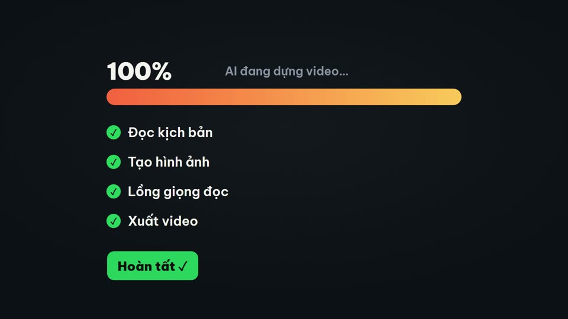](effects/task-progress/preview.mp4) | **[Thanh tiến trình kèm việc](effects/task-progress/)**<br>Thanh tải chạy từ 0 đến 100%, mỗi khi qua một mốc thì một việc trong danh sách đổi sang trạng thái xong, cuối cùng báo hoàn tất.<br><sub>Dùng khi: Minh hoạ quy trình tự động, AI đang làm việc, các bước xử lý đơn.</sub> | 6s |
| [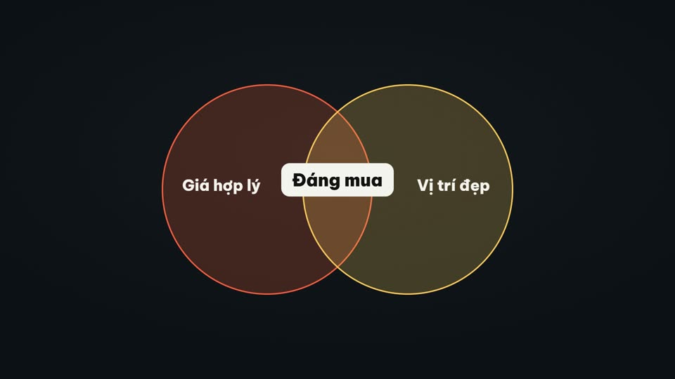](effects/venn-overlap/preview.mp4) | **[Hai vòng giao nhau](effects/venn-overlap/)**<br>Hai vòng tròn mờ trượt vào từ hai bên kèm nhãn, chồng lên nhau, phần giao sáng màu nhấn và hiện từ khoá kết luận.<br><sub>Dùng khi: Điểm chung của hai nhóm, sản phẩm đáp ứng hai nhu cầu, công thức A + B.</sub> | 6s |

## Chữ

| Xem trước | Hiệu ứng | Thời lượng |
|---|---|---|
| [](effects/glitch-word/preview.mp4) | **[Chữ nhiễu tách màu](effects/glitch-word/)**<br>Từ khoá xuất hiện kiểu tín hiệu lỗi: ba lớp màu lệch nhau, dải cắt ngang giật, rồi khớp lại thành chữ sạch.<br><sub>Dùng khi: Nhấn từ khoá, chuyển đoạn kiểu công nghệ, mở đầu nhanh.</sub> | 4s |
| [](effects/marker-highlight/preview.mp4) | **[Bút dạ quang tô từ khoá](effects/marker-highlight/)**<br>Đoạn văn hiện ra, nét bút dạ quang quét lần lượt qua các từ khoá theo nhịp đọc, đoạn còn lại mờ đi.<br><sub>Dùng khi: Nhấn ý chính trong trích dẫn, điều khoản, đoạn giải thích.</sub> | 6s |
| [](effects/type-correct/preview.mp4) | **[Gõ chữ rồi sửa từ](effects/type-correct/)**<br>Dòng chữ gõ như máy đánh chữ, con trỏ dừng, xoá lùi một từ rồi gõ lại từ đúng với màu nhấn.<br><sub>Dùng khi: Đổi góc nhìn ("không phải… mà là…"), chơi chữ, câu hook gây tò mò.</sub> | 6s |
| [](effects/outline-fill/preview.mp4) | **[Chữ viền đổ đầy màu](effects/outline-fill/)**<br>Chữ lớn chỉ có viền vẽ ra trước, sau đó màu đổ đầy từ dưới lên như nước dâng, dòng phụ hiện bên dưới.<br><sub>Dùng khi: Tiêu đề chương, con số lớn, tên thương hiệu.</sub> | 5s |
| [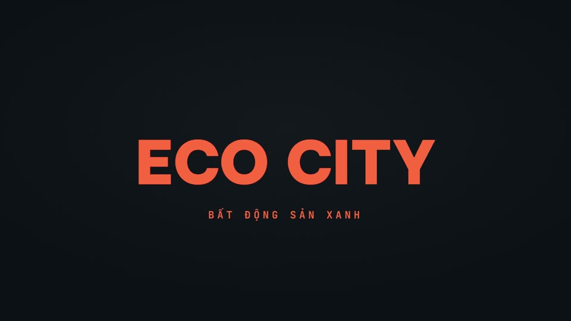](effects/letter-assemble/preview.mp4) | **[Ký tự bay về xếp chữ](effects/letter-assemble/)**<br>Các ký tự của từ khoá xuất phát từ những vị trí rải khắp khung hình, xoay và bay về xếp thành chữ hoàn chỉnh.<br><sub>Dùng khi: Tên thương hiệu, từ khoá chủ đề, khoảnh khắc chốt.</sub> | 5s |
| [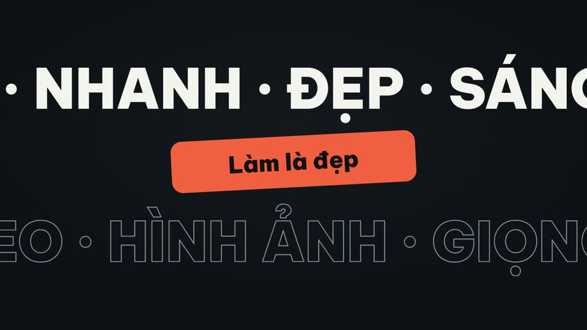](effects/marquee-rows/preview.mp4) | **[Hai dải chữ chạy ngược chiều](effects/marquee-rows/)**<br>Hai dải chữ lớn chạy ngang ngược chiều nhau, dải dưới viền rỗng, ở giữa bật lên một khẩu hiệu đứng yên.<br><sub>Dùng khi: Nền chữ động cho phần chuyển đoạn, khẩu hiệu thương hiệu, poster động.</sub> | 6s |

## Chuyển cảnh

| Xem trước | Hiệu ứng | Thời lượng |
|---|---|---|
| [](effects/tile-wipe/preview.mp4) | **[Chuyển cảnh ô lưới lật](effects/tile-wipe/)**<br>Màn hình chia lưới 8×5, các ô lật theo đường chéo để che cảnh cũ rồi lật tiếp để lộ cảnh mới.<br><sub>Dùng khi: Chuyển giữa hai đoạn, chuyển sang chương mới.</sub> | 3s |
| [](effects/circle-iris/preview.mp4) | **[Chuyển cảnh vòng tròn mở](effects/circle-iris/)**<br>Một chấm màu ở giữa nở thành vòng tròn phủ kín cảnh cũ, rồi vòng thứ hai mở ra từ đó để lộ cảnh mới.<br><sub>Dùng khi: Chuyển đoạn mềm mại, chuyển sang chủ đề mới, hiệu ứng "zoom vào".</sub> | 3s |
| [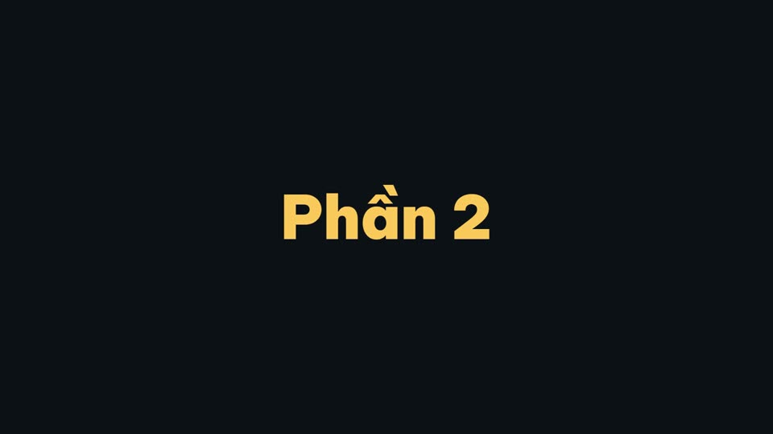](effects/stripe-wipe/preview.mp4) | **[Chuyển cảnh sọc chéo](effects/stripe-wipe/)**<br>Các sọc chéo hai màu quét ngang khung hình lệch nhịp, phủ kín cảnh cũ rồi rút đi để lộ cảnh mới.<br><sub>Dùng khi: Chuyển đoạn năng động, video thể thao, quảng cáo nhịp nhanh.</sub> | 3s |
| [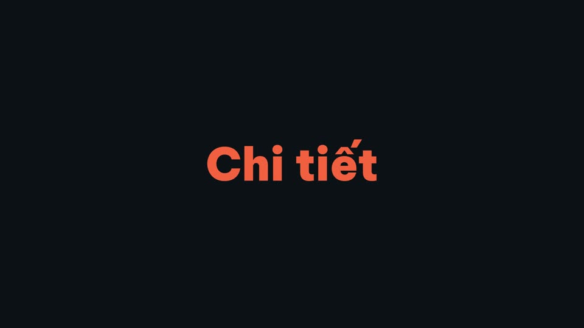](effects/zoom-push/preview.mp4) | **[Chuyển cảnh phóng xuyên](effects/zoom-push/)**<br>Cảnh cũ phóng to lao về phía máy quay và nhoè đi, cảnh mới từ xa thu vào đúng khung, tạo cảm giác lao xuyên qua.<br><sub>Dùng khi: Chuyển đoạn mạnh, chuyển từ tổng quan vào chi tiết.</sub> | 3s |
| [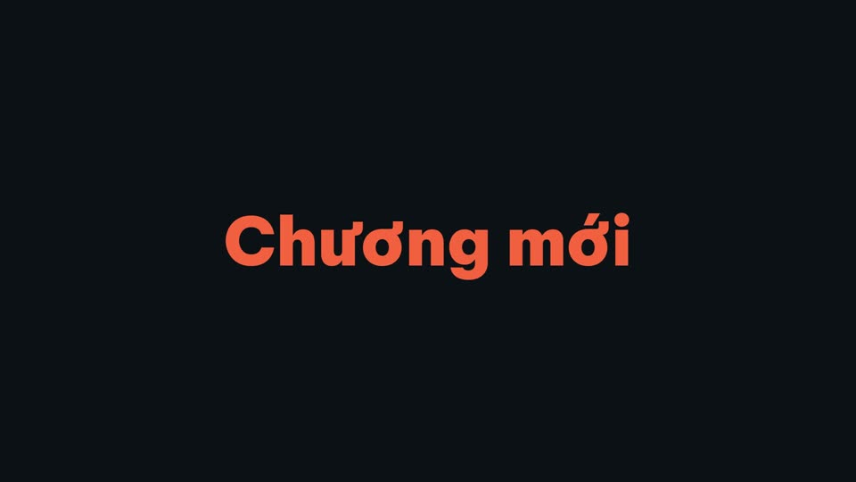](effects/split-slide/preview.mp4) | **[Chuyển cảnh tách đôi trượt](effects/split-slide/)**<br>Cảnh cũ cắt ngang làm hai, nửa trên trượt lên, nửa dưới trượt xuống, để lộ cảnh mới nằm phía sau với đường cắt sáng.<br><sub>Dùng khi: Chuyển chương, mở màn sản phẩm, chuyển cảnh gọn gàng.</sub> | 3s |

## Bất động sản

| Xem trước | Hiệu ứng | Thời lượng |
|---|---|---|
| [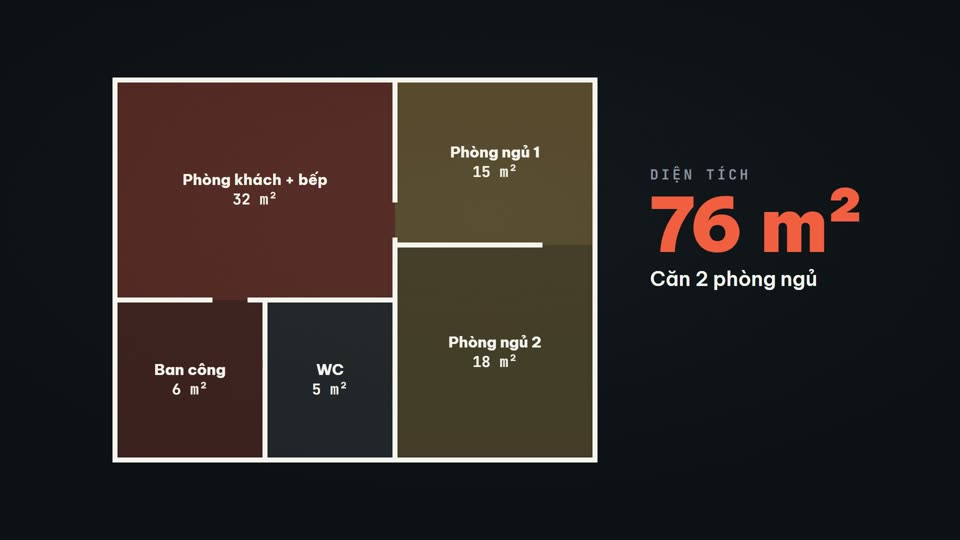](effects/floorplan-draw/preview.mp4) | **[Mặt bằng căn hộ tự vẽ](effects/floorplan-draw/)**<br>Nét tường vẽ dần thành mặt bằng căn hộ, từng phòng tô màu lần lượt kèm tên và diện tích, tổng diện tích đếm lên.<br><sub>Dùng khi: Giới thiệu căn hộ mẫu, layout nhà phố, so sánh loại căn.</sub> | 7s |
| [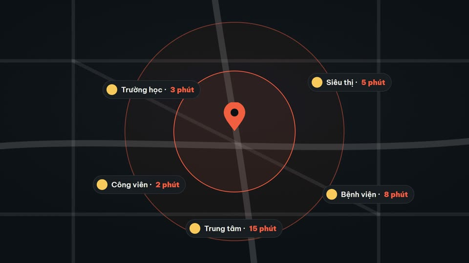](effects/location-radius/preview.mp4) | **[Vị trí và bán kính tiện ích](effects/location-radius/)**<br>Bản đồ đường phố cách điệu, ghim dự án cắm xuống giữa, vòng bán kính lan ra, các tiện ích quanh bật nhãn kèm số phút di chuyển.<br><sub>Dùng khi: Giới thiệu vị trí dự án, kết nối giao thông, tiện ích xung quanh.</sub> | 7s |
| [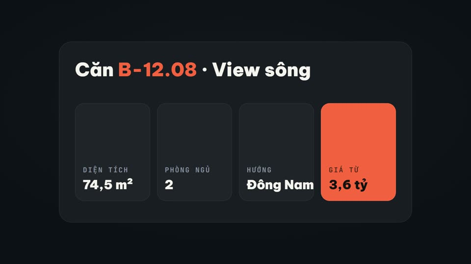](effects/unit-specs/preview.mp4) | **[Thẻ thông số căn](effects/unit-specs/)**<br>Thẻ lớn trượt vào, bốn ô thông số (diện tích, phòng ngủ, hướng, giá) bật lần lượt, số đếm lên, giá cuối nhấn màu.<br><sub>Dùng khi: Thông tin nhanh một loại căn, một lô đất, một sản phẩm.</sub> | 6s |
| [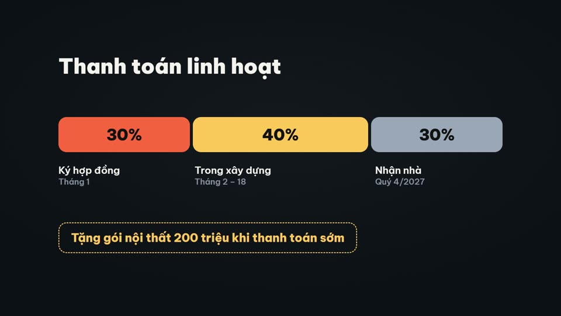](effects/payment-plan/preview.mp4) | **[Tiến độ thanh toán](effects/payment-plan/)**<br>Thanh ngang chia đoạn theo tỉ lệ thanh toán, từng đoạn mọc ra kèm phần trăm và mốc thời gian bên dưới, ưu đãi nổi lên cuối.<br><sub>Dùng khi: Phương thức thanh toán, trả góp, các đợt đóng tiền.</sub> | 6s |
| [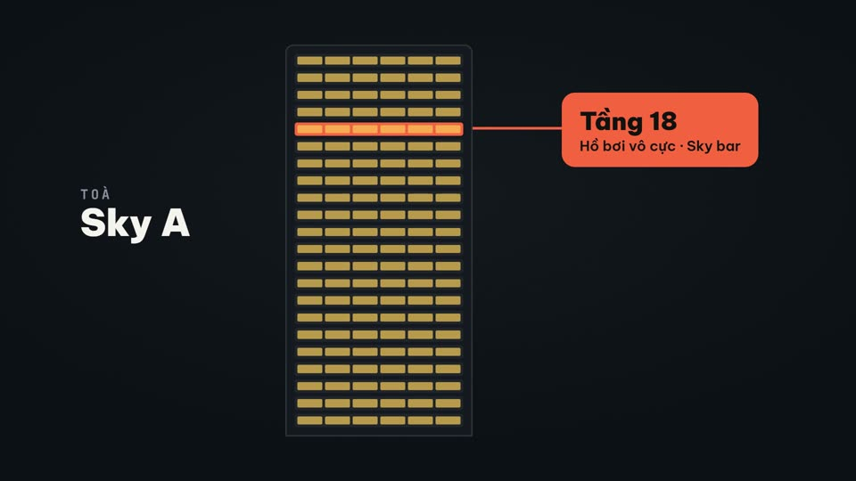](effects/tower-floors/preview.mp4) | **[Toà nhà sáng từng tầng](effects/tower-floors/)**<br>Khối toà nhà cách điệu, các tầng bật đèn từ dưới lên, một tầng được chọn sáng màu nhấn và kéo nhãn chú thích ra ngoài.<br><sub>Dùng khi: Giới thiệu toà, tầng đẹp, tầng tiện ích, căn còn trống.</sub> | 6s |

## Mạng xã hội

| Xem trước | Hiệu ứng | Thời lượng |
|---|---|---|
| [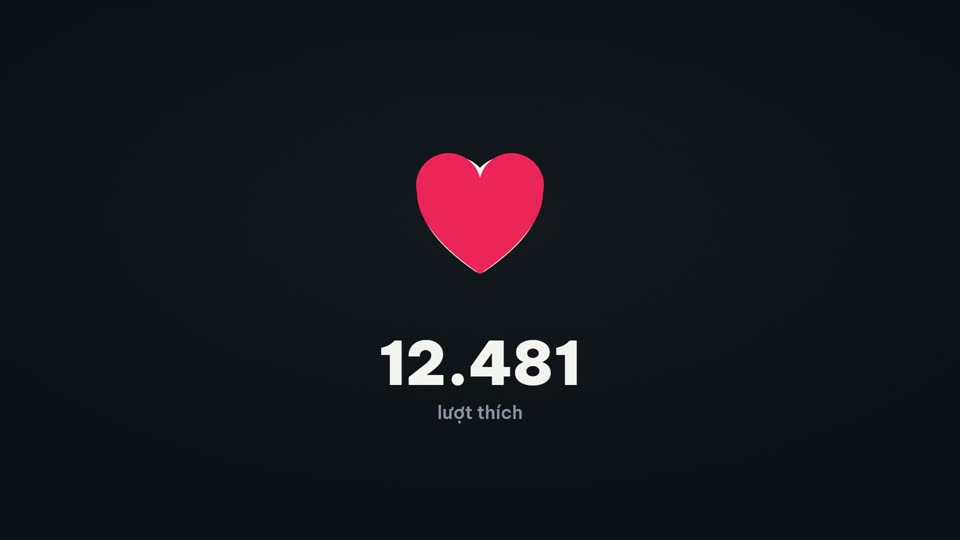](effects/like-burst/preview.mp4) | **[Tim nổ và số thích](effects/like-burst/)**<br>Nút tim lớn được bấm, tim co lại rồi bung đỏ, vòng hạt nổ tỏa ra, số lượt thích nhảy lên.<br><sub>Dùng khi: Kêu gọi thả tim, khoe tương tác, mở đầu video mạng xã hội.</sub> | 4s |
| [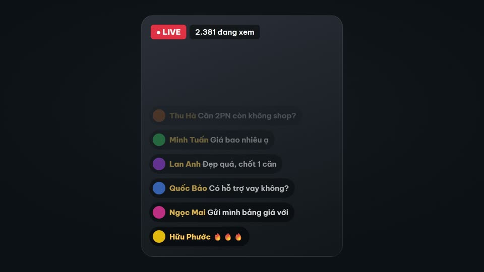](effects/live-comments/preview.mp4) | **[Bình luận livestream trôi lên](effects/live-comments/)**<br>Khung livestream có nhãn LIVE, bình luận của người xem lần lượt hiện ở dưới và đẩy các bình luận cũ trôi lên, mờ dần.<br><sub>Dùng khi: Minh hoạ livestream bán hàng, phản hồi khách, không khí sôi động.</sub> | 7s |
| [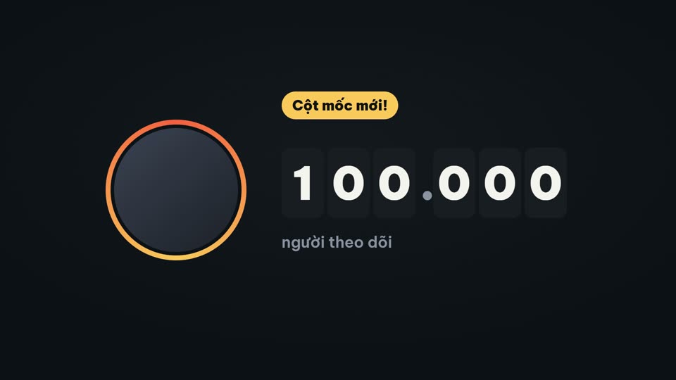](effects/follower-odometer/preview.mp4) | **[Đồng hồ số người theo dõi](effects/follower-odometer/)**<br>Ảnh đại diện tròn có viền màu, bên cạnh dãy chữ số lăn như đồng hồ công-tơ-mét dừng ở con số mới, nhãn cột mốc bật lên.<br><sub>Dùng khi: Khoe cột mốc người theo dõi, lượt đăng ký kênh, khách hàng.</sub> | 5s |
| [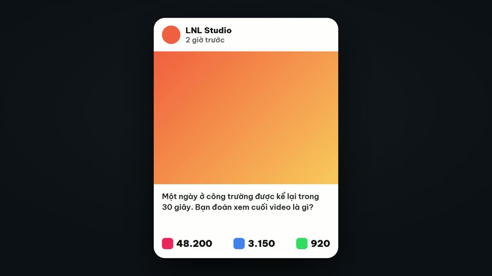](effects/social-post/preview.mp4) | **[Bài đăng nổi tương tác](effects/social-post/)**<br>Thẻ bài đăng mạng xã hội trượt vào với ảnh, chú thích và hàng nút; số thích, bình luận, chia sẻ đếm lên lần lượt.<br><sub>Dùng khi: Khoe bài viral, minh hoạ chiến dịch, kết quả quảng cáo.</sub> | 6s |

## 3D

| Xem trước | Hiệu ứng | Thời lượng |
|---|---|---|
| [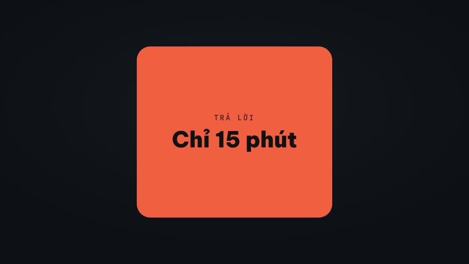](effects/card-flip/preview.mp4) | **[Thẻ lật 3D](effects/card-flip/)**<br>Thẻ lớn nghiêng trong không gian, lật 180 độ quanh trục dọc để lộ mặt sau với câu trả lời, bóng đổ đổi theo góc lật.<br><sub>Dùng khi: Câu hỏi và đáp án, trước và sau, tiết lộ giá hay quà tặng.</sub> | 5s |
| [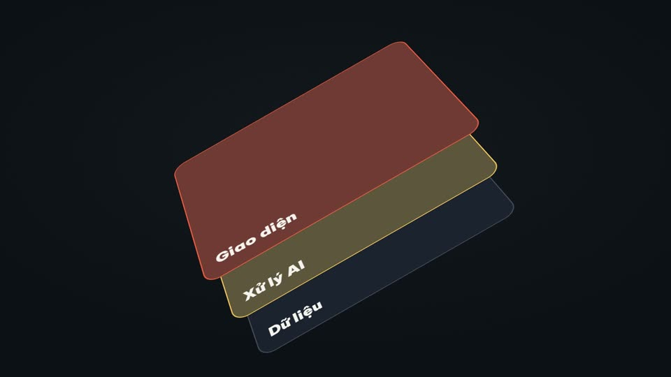](effects/depth-layers/preview.mp4) | **[Lớp thẻ tách chiều sâu](effects/depth-layers/)**<br>Ba lớp giao diện chồng khít nhau trong góc nghiêng 3D rồi tách ra theo chiều sâu, mỗi lớp lộ nhãn chức năng, sau đó gộp lại.<br><sub>Dùng khi: Giải thích cấu trúc sản phẩm, các lớp dịch vụ, kiến trúc hệ thống.</sub> | 6s |
| [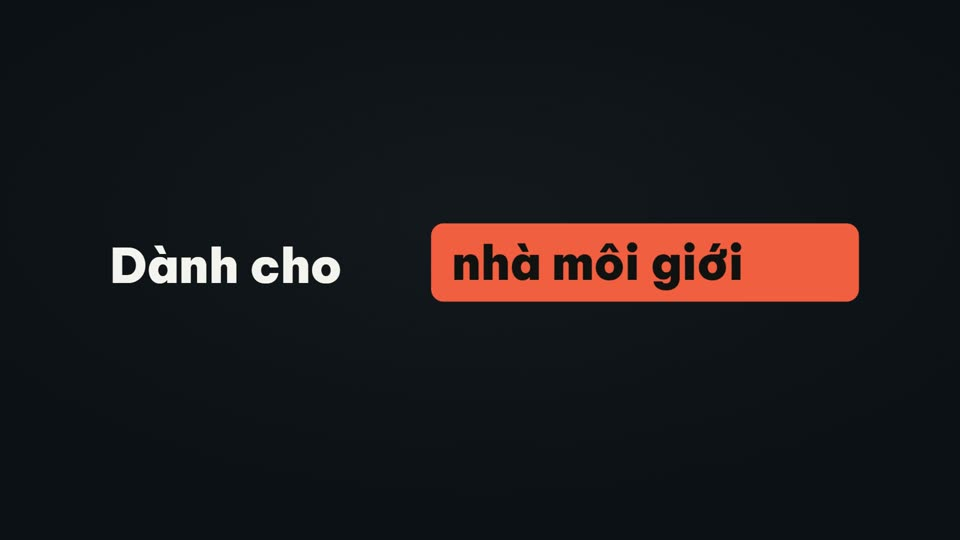](effects/cube-words/preview.mp4) | **[Khối lập phương đổi chữ](effects/cube-words/)**<br>Một dải khối lập phương xoay từng mặt, mỗi lần lật đổi sang một từ mới, câu dẫn bên trái đứng yên.<br><sub>Dùng khi: Liệt kê nhiều lợi ích, nhiều đối tượng khách, "dành cho …".</sub> | 6s |

## Kết video

| Xem trước | Hiệu ứng | Thời lượng |
|---|---|---|
| [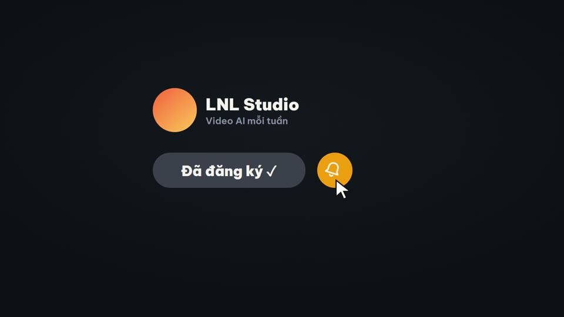](effects/end-subscribe/preview.mp4) | **[Nút đăng ký và chuông](effects/end-subscribe/)**<br>Con trỏ di chuyển tới nút Đăng ký, bấm, nút đổi màu thành Đã đăng ký, chuông bên cạnh rung và sáng lên.<br><sub>Dùng khi: Cuối video YouTube, kêu gọi theo dõi kênh.</sub> | 5s |
| [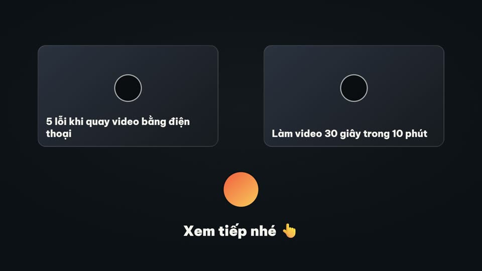](effects/end-next-videos/preview.mp4) | **[Màn kết gợi ý video](effects/end-next-videos/)**<br>Hai khung video gợi ý trượt vào hai bên, ảnh kênh tròn ở giữa phía dưới, dòng "Xem tiếp" và mũi tên chỉ sang hai khung.<br><sub>Dùng khi: Màn kết YouTube (end screen), điều hướng sang video khác.</sub> | 6s |
| [](effects/cta-qr/preview.mp4) | **[Mã QR và lời kêu gọi](effects/cta-qr/)**<br>Khung mã QR vẽ dần từng ô vuông, khung quét chạy dọc, bên cạnh lời kêu gọi và hotline hiện lần lượt.<br><sub>Dùng khi: Cuối video quảng cáo, mời quét mã nhận ưu đãi, đặt lịch tham quan.</sub> | 6s |

## Nhạc & nhịp

| Xem trước | Hiệu ứng | Thời lượng |
|---|---|---|
| [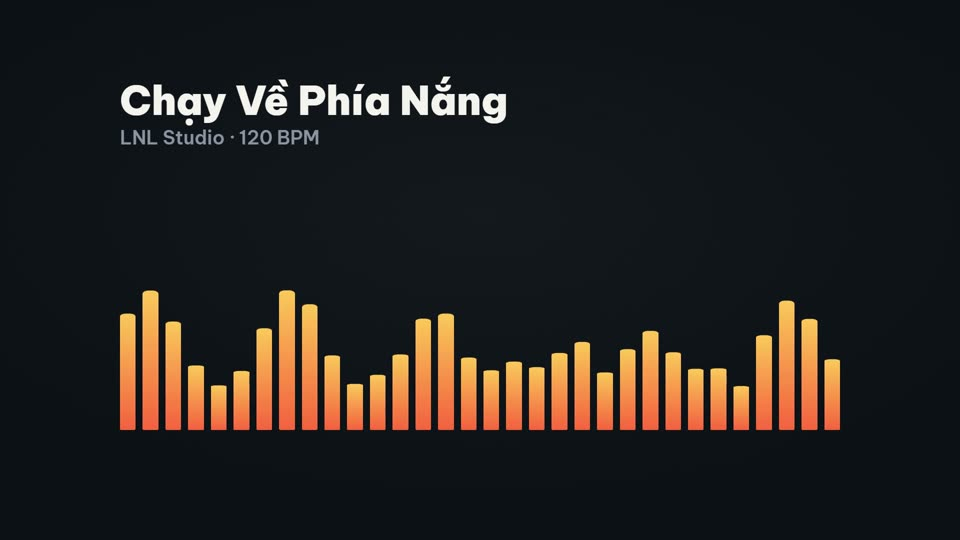](effects/eq-bars/preview.mp4) | **[Cột âm lượng nhảy theo nhạc](effects/eq-bars/)**<br>Dãy cột equalizer nhảy lên xuống theo nhịp, màu chuyển dần từ cam sang vàng, tên bài hát và nghệ sĩ hiện bên trên.<br><sub>Dùng khi: Video nhạc, podcast, mở đầu chương trình có nhạc nền.</sub> | 6s |
| [](effects/beat-title/preview.mp4) | **[Chữ đập theo nhịp](effects/beat-title/)**<br>Tiêu đề phóng nhẹ theo mỗi phách 120 BPM, vòng sóng tỏa ra phía sau ở phách mạnh, nền chớp nhẹ theo nhịp.<br><sub>Dùng khi: Intro theo nhạc, reel nhịp nhanh, đoạn cao trào.</sub> | 6s |
| [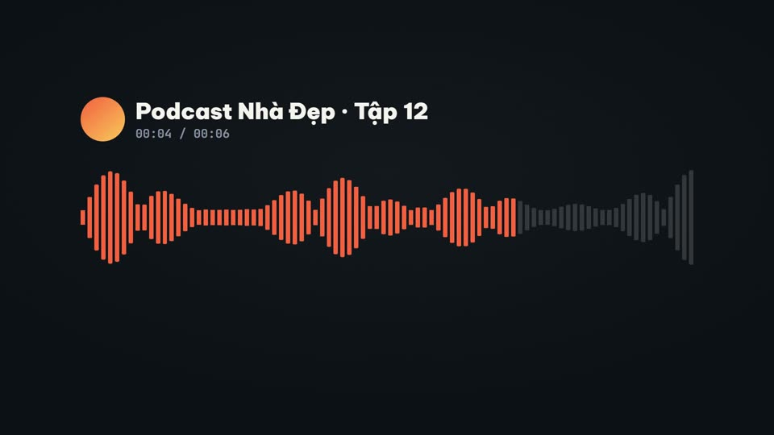](effects/waveform-voice/preview.mp4) | **[Sóng âm giọng đọc](effects/waveform-voice/)**<br>Dải sóng âm đối xứng chạy theo thời gian, đầu đọc sáng quét ngang, nhãn tên người nói và thời lượng phía trên.<br><sub>Dùng khi: Podcast, audiogram, trích đoạn phỏng vấn, giọng đọc AI.</sub> | 6s |

## Biểu đồ

| Xem trước | Hiệu ứng | Thời lượng |
|---|---|---|
| [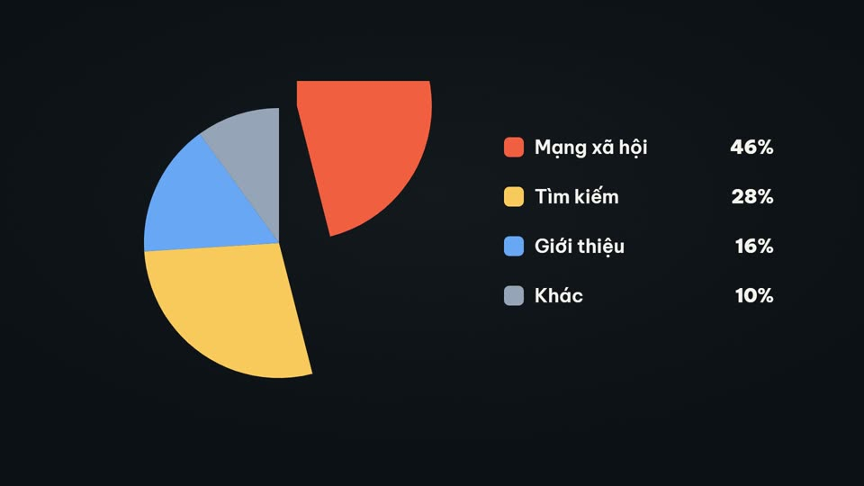](effects/pie-slices/preview.mp4) | **[Biểu đồ tròn tách lát](effects/pie-slices/)**<br>Biểu đồ tròn vẽ từng lát theo chiều kim đồng hồ, lát lớn nhất tách ra khỏi tâm, chú thích phần trăm hiện bên phải.<br><sub>Dùng khi: Cơ cấu khách hàng, tỉ trọng doanh thu, phân bổ ngân sách.</sub> | 6s |
| [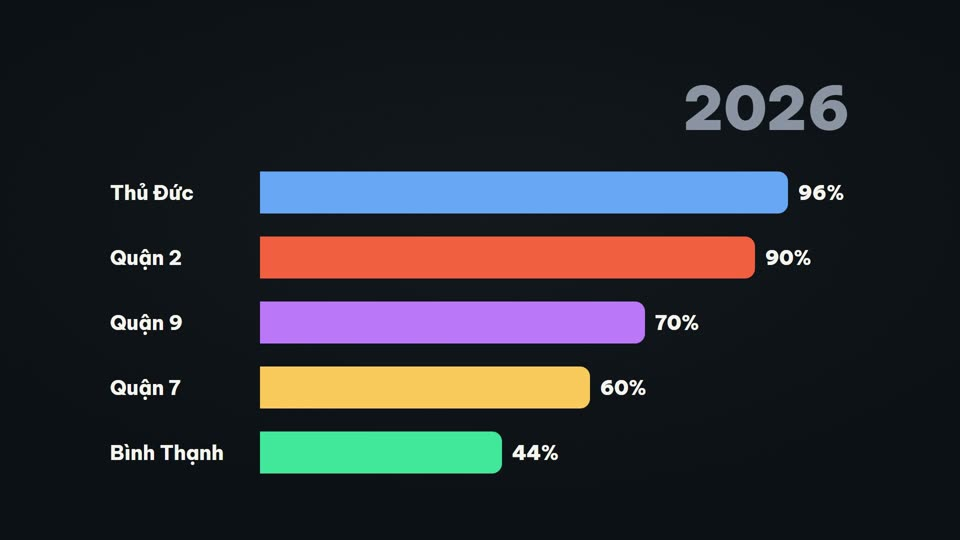](effects/hbar-rank/preview.mp4) | **[Thanh ngang đổi hạng](effects/hbar-rank/)**<br>Năm thanh ngang mọc ra theo giá trị năm đầu, rồi giá trị đổi sang năm sau, các thanh dài ra và đổi chỗ theo thứ hạng.<br><sub>Dùng khi: So sánh thị phần, xếp hạng khu vực, tăng trưởng giữa hai mốc.</sub> | 7s |
| [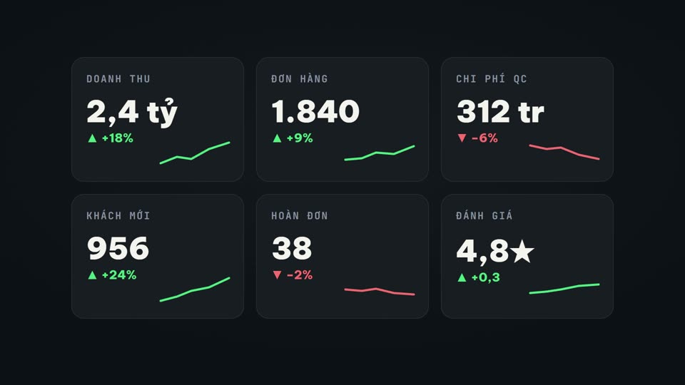](effects/kpi-grid/preview.mp4) | **[Lưới chỉ số kinh doanh](effects/kpi-grid/)**<br>Sáu ô chỉ số hiện theo đường chéo, mỗi ô đếm số kèm mũi tên tăng xanh hoặc giảm đỏ và đường xu hướng nhỏ tự vẽ.<br><sub>Dùng khi: Báo cáo tháng, dashboard nhanh, tổng kết chiến dịch.</sub> | 6s |

## Bản đồ

| Xem trước | Hiệu ứng | Thời lượng |
|---|---|---|
| [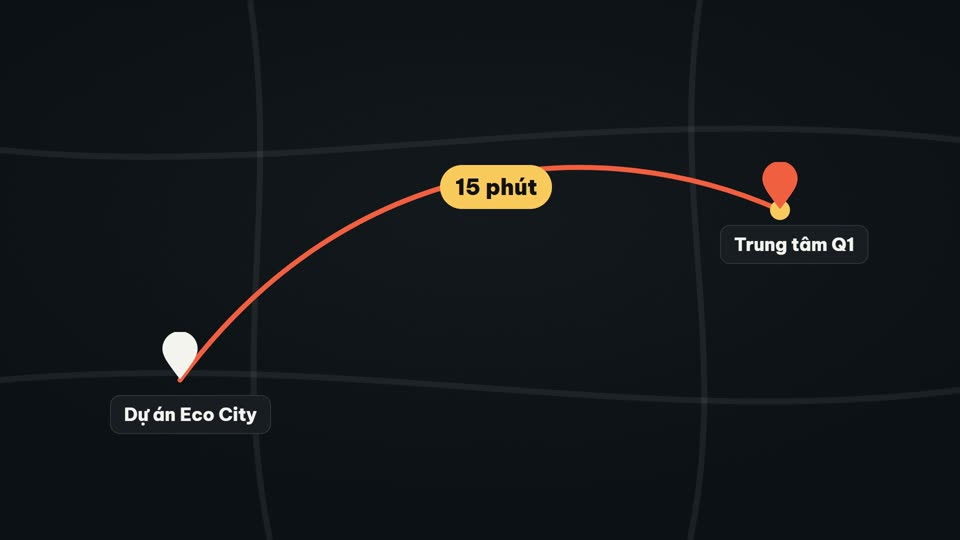](effects/route-draw/preview.mp4) | **[Tuyến đường vẽ giữa hai điểm](effects/route-draw/)**<br>Hai ghim điểm đi và điểm đến cắm xuống, đường nét đứt cong tự vẽ nối hai điểm, chấm sáng chạy dọc tuyến, nhãn thời gian hiện giữa đường.<br><sub>Dùng khi: Khoảng cách tới trung tâm, tuyến giao thông mới, lộ trình giao hàng.</sub> | 6s |
| [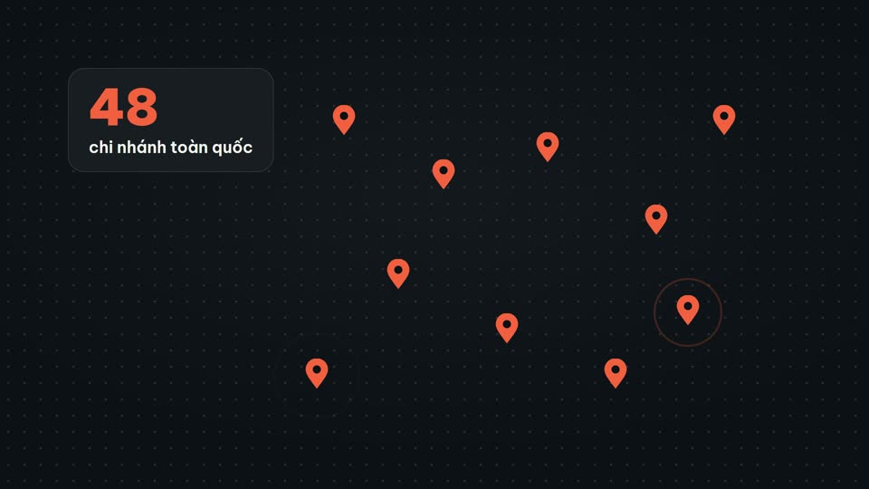](effects/branch-pins/preview.mp4) | **[Ghim chi nhánh rơi xuống](effects/branch-pins/)**<br>Lưới chấm bản đồ hiện mờ, các ghim rơi xuống lần lượt ở nhiều vị trí, mỗi ghim tỏa vòng sáng, bộ đếm số chi nhánh tăng theo.<br><sub>Dùng khi: Mạng lưới cửa hàng, đại lý toàn quốc, số dự án đã triển khai.</sub> | 6s |

## Người nói

| Xem trước | Hiệu ứng | Thời lượng |
|---|---|---|
| [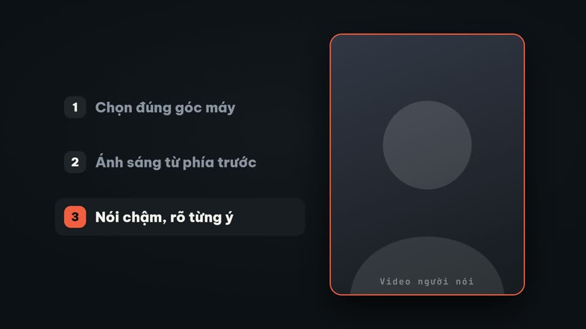](effects/speaker-side-points/preview.mp4) | **[Người nói lệch phải kèm ý chính](effects/speaker-side-points/)**<br>Khung người nói thu nhỏ trượt sang phải, bên trái các ý chính hiện lần lượt kèm số thứ tự, ý đang nói sáng màu nhấn.<br><sub>Dùng khi: Video talking head có liệt kê ý, bài giảng, review sản phẩm.</sub> | 7s |
| [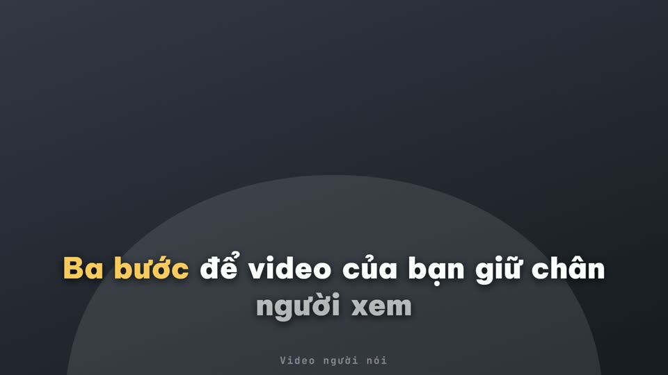](effects/karaoke-caption/preview.mp4) | **[Phụ đề tô màu từng từ](effects/karaoke-caption/)**<br>Phụ đề lớn ở dưới khung người nói, từng từ sáng lên và nảy nhẹ đúng lúc được nói, từ khoá đổi màu nhấn.<br><sub>Dùng khi: Phụ đề kiểu TikTok / Reels cho video người nói, giọng đọc.</sub> | 6s |
| [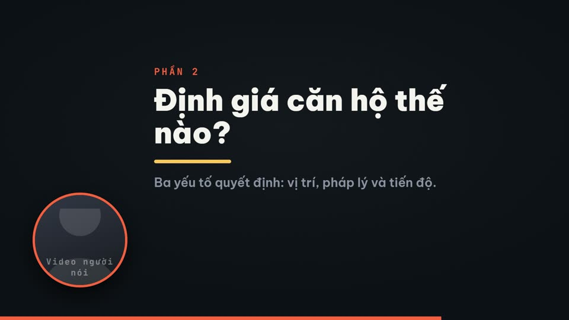](effects/speaker-pip-topic/preview.mp4) | **[Khung tròn người nói và chủ đề](effects/speaker-pip-topic/)**<br>Khung người nói tròn ở góc dưới trái nảy ra, thẻ chủ đề lớn chiếm phần còn lại với tiêu đề và gạch nhấn, thanh tiến trình chạy dưới đáy.<br><sub>Dùng khi: Video giải thích có người nói nhỏ ở góc, bài giảng trên slide.</sub> | 6s |

## Nền chuyển động

| Xem trước | Hiệu ứng | Thời lượng |
|---|---|---|
| [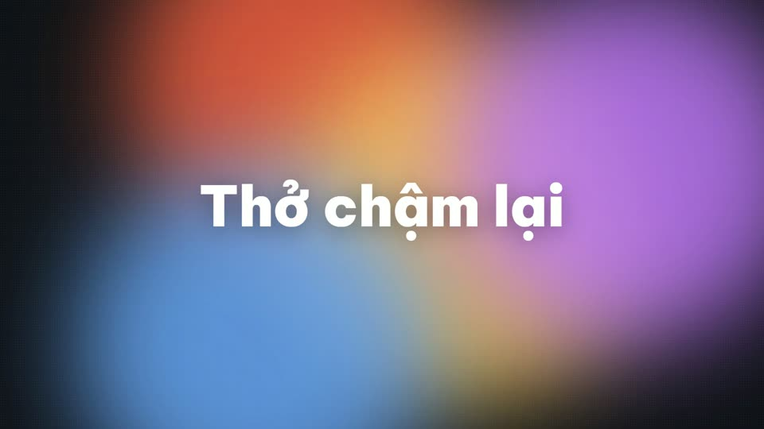](effects/gradient-blobs/preview.mp4) | **[Nền khối màu trôi](effects/gradient-blobs/)**<br>Các khối màu lớn nhoè mờ trôi chậm và đổi chỗ cho nhau như dung nham, tiêu đề đứng yên phía trên, dùng làm nền cho chữ.<br><sub>Dùng khi: Nền cho tiêu đề, trích dẫn, màn chờ, video thư giãn.</sub> | 8s |
| [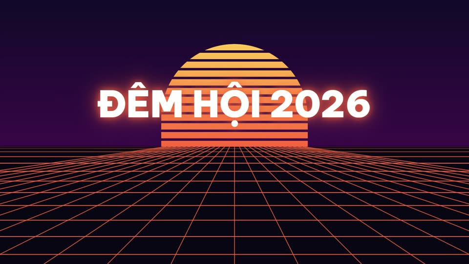](effects/retro-grid/preview.mp4) | **[Lưới phối cảnh chạy tới](effects/retro-grid/)**<br>Mặt lưới phối cảnh trải về đường chân trời và chạy liên tục về phía người xem, mặt trời sọc lặn phía sau, tiêu đề phát sáng.<br><sub>Dùng khi: Phong cách retro, giới thiệu sự kiện, mở đầu kênh công nghệ.</sub> | 6s |
| [](effects/dot-wave/preview.mp4) | **[Lưới chấm gợn sóng](effects/dot-wave/)**<br>Lưới chấm phủ kín khung hình, sóng tròn lan ra từ tâm làm chấm phồng to và sáng màu theo nhịp, chữ hiện ở giữa.<br><sub>Dùng khi: Nền công nghệ, mở đầu sản phẩm AI, màn chờ livestream.</sub> | 6s |

## Bộ màu

| Bộ | Nền | Nhấn | Nhấn 2 |
|---|---|---|---|
| Than & cam san hô | #0e1116 | #ff6b3d | #ffc857 |
| Đêm xanh | #07101f | #4f8bff | #7cf0d4 |
| Rừng xanh | #0c1510 | #5ed17e | #e9d36a |
| Giấy sáng | #f6f2ea | #e8461f | #2f6bff |

## Giấy phép
Mã nguồn theo giấy phép MIT (xem `LICENSE`). Phông Be Vietnam Pro, JetBrains Mono và Bricolage Grotesque (trang thư viện) theo SIL Open Font License.
